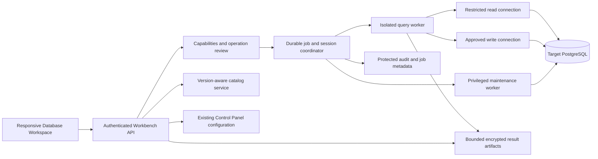

# PostgreSQL Database Workspace: architecture and delivery plan

**Status:** architecture baseline complete. The user authorized implementation on 3 November 2026; progress and evidence are tracked in [the implementation record](database-workspace-implementation.md).

**Prepared:** 3 November 2026, Europe/Warsaw.

**Delivery contract:** one complete release, after all required work packages and acceptance gates pass. Work packages below are implementation dependencies, not separate releases.

**Current route:** `/settings/sql-helper`. Preserve this entry point.

**Planning baseline:** local branch `codex/manifest-product-amend`, commit `ce9253e1`; SQL Helper files inspected are unchanged from local `origin/master`. Preserve the existing, unreleased manifest amendment work.

The planning-only task was completed before development began. The current instruction is to implement the complete package until it is ready to push, create the PR and deploy. Do not publish an intermediate release. The original planning audit below remains historical evidence; consult the implementation record for current behavior.

### Contents

- [Product and release scope](#1-product-decision)
- [Verified audit and unknowns](#2-what-was-inspected-and-what-remains-unknown)
- [Complete feature contract](#3-feature-contract-for-the-single-release)
- [Desktop/mobile UX](#4-ux-and-information-architecture)
- [Data browsing, results, editing and imports](#5-object-explorer-results-and-data-management)
- [PostgreSQL analysis and administration](#6-postgresql-analysis-and-administration)
- [Access and execution architecture](#7-access-and-execution-architecture)
- [Persistence and API contracts](#8-persistence-and-api-contracts)
- [Configuration, audit and operations](#9-configuration-audit-privacy-and-operational-limits)
- [Technology and module structure](#10-technology-choices-and-implementation-structure)
- [Internal work packages](#11-internal-work-packages-one-release-only)
- [Acceptance tests](#12-test-plan-and-acceptance-gates)
- [Single deployment and rollback](#13-migration-single-deployment-and-rollback)
- [Decisions and handoff](#14-decisions-to-carry-into-implementation)
- [References](#16-references)

## 1. Product decision

Replace the current SQL Helper with an integrated **Database Workspace** for PostgreSQL. It should make routine investigation, data correction, query development, schema work, and database administration coherent in OmniLodge, with a serious desktop workspace and deliberately designed mobile workflows.

The quality benchmark is the breadth of an established PostgreSQL administration tool such as pgAdmin, combined with OmniLodge's authentication, audit history, configuration, and business context. Popularity is not a deliverable we can promise. The deliverable is a complete, reliable platform with explicit supported operations and verifiable behavior.

Build the OmniLodge workspace using maintained editor/grid/database components. Do not hand-build another SQL tokenizer, an entire grid engine, or PostgreSQL backup tooling. Do not iframe a shared superuser pgAdmin session into OmniLodge. A separately authenticated pgAdmin installation can remain an operational fallback, but it does not count as implementing the features in this plan.

### Complete release scope

The release includes the workspace shell; connection/environment identity; schema/object explorer; mature SQL editor; query tabs, drafts, history and saved queries; durable execution and cancellation; typed results; advanced filtering/sorting/columns; copy and exports; table editing; imports; explain plans; activity/locks/health; common PostgreSQL object administration; dependencies and ERD; schema comparison and migration script preparation; privileges; maintenance; backup/restore workflows; approved scheduled database jobs; and responsive/accessibility behavior throughout.

Database capabilities vary by server version, role, and installed extensions. A feature may correctly report **Unavailable on this connection: reason**, rather than appear broken or display zero. This is capability detection, not an excuse for an unfinished feature. Unsupported infrastructure capabilities must be identified and agreed before the final release.

### Deliberate boundaries

- PostgreSQL only. MySQL, SQL Server, and generic multi-database support are outside this release.
- No public database console, arbitrary browser-supplied connection strings, web terminal, or arbitrary shell execution.
- No assumption that an application Owner, Manager, or product-scoped role is a database administrator.
- No automatic AI execution. An AI SQL assistant, procedural debugger, real-time collaborative editing, and geospatial map editor are separate future proposals, not hidden unfinished items in this release.
- No promise of a universal Undo after commit, automatic index optimization, automatic resolution of conflicting schema changes, or zero-impact production diagnostics.
- No replacement for application workflows. Direct SQL does not automatically send booking emails, call Stripe, recalculate a payout ledger, or preserve every application-level invariant.

## 2. What was inspected and what remains unknown

### Verified evidence

The authenticated production page was inspected on desktop and in a 390 × 844 touch viewport. No query was manually executed; opening the existing page performs its normal schema metadata request. No customer results were exported or copied into this document. The existing default editor text was `SELECT NOW();`.

The production screen shows a large Settings sidebar, an unrelated **Control Panel** heading/subtitle, one SQL input, **Beautify SQL**, and **Execute**. The narrow layout fits, but still presents the same form; it has no mobile-specific query/result navigation. Desktop navigation highlights Overview while the SQL page is open.

Source audit covered:

| Area | Repository evidence |
|---|---|
| SQL execution and routing | `be/src/controllers/sqlHelperController.ts`, `be/src/routes/sqlHelperRoutes.ts` |
| Authentication and product scope | `be/src/middleware/authorizationMiddleware.ts`, `be/src/services/productScopedApiPolicy.ts` |
| Editor, completion and results | `ui/src/components/sql/SqlHelperPanel.tsx` |
| API and page identity | `ui/src/api/sqlHelper.ts`, `ui/src/pages/settings/SettingsSqlHelper.tsx` |
| Settings chrome/navigation | `ui/src/pages/settings/SettingsLayout.tsx`, `ui/src/components/navbars/AppNavbarSettings.tsx` |
| Runtime configuration | `be/src/config/appConfigRegistry.ts`, `be/src/services/configService.ts` |
| Existing jobs and audit | `be/src/services/reporting/reportQueryService.ts`, `be/src/models/ReportAsyncJob.ts`, `be/src/models/AuditLog.ts` |
| Existing backup facilities | `be/src/services/dbBackupService.ts`, `ui/src/components/settings/DbBackupsPanel.tsx` |
| Reusable table/export patterns | `RevenueBookingsTable.tsx`, `BookingTableExportControls.tsx`, `bookingTableExport.ts` under `ui/src` |

The code findings below are not claims that an exploit was tested in production. The deployed source SHA, actual PostgreSQL privileges, and infrastructure defaults were not independently verified in this planning audit.

### Current gaps, in priority order

| Priority | Finding | Required correction |
|---|---|---|
| Critical foundation | Queries use the main application Sequelize connection manager. | Dedicated execution credentials, capacity, and worker lifecycle; booking/payment requests must not compete for its connections. |
| Critical foundation | The 500-row cap is applied after all rows return from the driver. | Bound fetching, result bytes, runtime, worker memory, and storage. A display limit is not a resource limit. |
| Critical foundation | First-keyword classification treats `WITH`, `SELECT`, and `EXPLAIN` as reads. | Real parser for policy/diagnostics plus database privilege enforcement. These words do not prove a statement is harmless. |
| Critical foundation | Sequential statements can autocommit before a later failure; the failure response hides earlier results. | Explicit execution modes, durable per-statement outcomes, and an unambiguous commit status. |
| Critical foundation | Transaction state is a Boolean inferred from leading words. `ROLLBACK TO` and `COMMIT AND CHAIN` do not fit this model. | Server-owned transactions for ordinary jobs; a proper connection/session state machine for expert sessions. |
| Critical foundation | Connections are released without general session cleanup; rollback failures are ignored. | Close uncertain connections; never return user-controlled session state to the application pool. |
| High | No SQL-specific cancellation, audit trail, concurrency budget, or timeout setup appears in the executor. | Protected execution records, bounded jobs, cancellation and monitoring. Database/host defaults must also be inspected. |
| High | Body trimming and connection-manager lookup happen outside the controller's normal error handling. | Runtime request validation, bounded inputs, and consistent error responses. |
| High | Object rows and inferred column names lose duplicate labels and empty-result metadata. | Ordinal field descriptors and typed array rows from driver metadata. |
| High | The HTTP response includes an automatic rollback warning, but the frontend API type and UI omit it. | Treat transaction outcome as a required field, not an optional message. |
| UX | Custom transparent textarea/highlight overlay, completion parsing, and formatting are maintained in one large component. | A mature editor with real accessibility, language support, and isolated components. |
| UX | Visible editor label is not connected to the textarea; completion lacks appropriate accessibility semantics. | Named editor, keyboard and screen-reader completion, live status, accessible result navigation. |
| UX | No tabs, history, object browser, data editing, exports, plans, or job recovery. | Implement the complete feature contract below. |
| Access | The frontend reuses `settingsActions`; the backend requires normalized `admin` (`administrator` maps to it). | Dedicated workspace page/action permissions. Preserve the actual backend boundary initially. |

No dedicated SQL Helper executor/UI tests were found in the inspected test searches; product-scoped API denial has coverage. New tests must exercise a real PostgreSQL instance as well as UI and controller behavior.

### Discovery required before implementation decisions are frozen

Record production and local PostgreSQL major/minor versions; server topology; connection limits; PgBouncer/proxy mode if any; TLS; database sizes and largest relations; application and maintenance role grants; schema ownership; RLS; callable security-definer/extension functions; timeouts; available monitoring extensions; backup formats/storage/retention; restore duration; and existing WAL/PITR coverage.

Also measure current application connection/memory headroom and release-host capacity. Do not infer PostgreSQL version from the documentation website or treat a configured backup path as proof of a usable backup. These are targeted, read-only discovery tasks; destructive rehearsal belongs in a disposable restored database.

## 3. Feature contract for the single release

All rows marked **Required** are release gates. Capability-dependent operations still require implementation, tests, and clear availability reasons.

| ID | Feature | Required behavior |
|---|---|---|
| F01 | Workspace and targets | Desktop/mobile layouts, clear environment/database/effective role, search, theme/density, connection health, recent objects. Required. |
| F02 | Object explorer | Lazy schema tree, object search, favorites, definitions, columns/types/defaults, keys, indexes, policies, comments, size/statistics, dependencies. Required. |
| F03 | SQL editor | PostgreSQL syntax, schema-aware completion, formatting, selection/current/all execution, diagnostics, find/replace, multiple tabs, parameters, snippets. Required. |
| F04 | Execution | Server-enforced modes, durable jobs, atomic batches, explicit expert sessions, cancel/status/reconnect, limits, audit. Required. |
| F05 | Results | Typed virtualized/paged grid, value inspector, selection/copy, multi-sort/filter conditions, visibility/order/pinning/resizing, accurate scope/counts. Required. |
| F06 | Query library | Private drafts, revisioned saved queries, folders/tags/favorites, explicit sharing, parameter forms, personal and authorized team history. Required. |
| F07 | Export/share | CSV, JSON, XLSX, SQL data export, PDF and bounded image capture; clipboard where supported; visible/filtered/all scope; authenticated links. Required. |
| F08 | Data changes | Staged insert/update/delete for eligible tables, typed controls, conflict detection, before/after review, transactional save. Required. |
| F09 | Import | CSV/JSON input, column mapping, validation, duplicate policy, staging, review, transactional bounded import, row errors. Required. |
| F10 | Query analysis | Estimated/actual JSON plans, graphical/tree/table views, node inspector, plan comparison, explainable diagnostics. Required. |
| F11 | Activity/health | Sessions, waits, blockers, locks, long transactions, workload metrics, capacity, table/index/vacuum health; authorized cancel/terminate. Required. |
| F12 | Schema development | Common object create/alter/drop forms and SQL generation, dependencies, ERD, schema diff, migration script preparation and drift visibility. Required. |
| F13 | Privilege administration | Role/membership/object/default-privilege inspection and controlled changes; RLS visibility. Required, privilege-dependent. |
| F14 | Maintenance/recovery | Analyze/vacuum/reindex/refresh workflows, job progress, existing backup integration, isolated restore and explicit production restore runbook. Required. |
| F15 | Scheduled jobs | Versioned, approved, bounded database maintenance/report jobs; execution history, disable/pause, missed-run and overlap policies. Required. |
| F16 | Quality/operations | Accessibility, real mobile testing, permissions, observability, quotas/cleanup, deployment/rollback and recovery rehearsal. Required. |

## 4. UX and information architecture

### 4.1 Navigation and visual design

Keep the Settings entry, rename its display label **Database Workspace**, and preserve `/settings/sql-helper` bookmarks. Enter a focused workspace with a compact OmniLodge header and a clear **Back to settings** action. Replace the generic Control Panel heading. Collapse the long Settings menu rather than allocating a permanent third of the screen to it.

Workspace sections: **Query**, **Objects**, **Activity**, **Saved queries**, **History**, **Administration**. Administration contains Schema compare, Roles & privileges, Maintenance, Backups & restore, and Scheduled jobs. Object details open as contextual tabs, not unrelated full-page forms.

Use existing Mantine design tokens and one icon family. Neutral surfaces, modest borders, readable typography, compact toolbars, and predictable spacing suit long database sessions. Reserve strong color for environment, pending edits, errors, and operation state. Do not fill the workspace with decorative KPI cards. Production is identified by text and an icon as well as color. Support light/dark themes, comfortable/compact density, and resettable per-user layout preferences.

### 4.2 Desktop wireframe

```text
+--------------------------------------------------------------------------------+
| Database Workspace  [Production / omni_lodge] [Read mode] [Connected]  Search [?] |
+--------------------+-----------------------------------------------------------+
| Objects     Search | Query 1 * | Booking check | table: bookings | +             |
| public             +-----------------------------------------------------------+
|   Tables           | [Run current v] [Explain v] [Format] [Save] [Export]       |
|     bookings       | 1  SELECT ...                               | Inspector    |
|     ...            | 2  ...                                      | Properties   |
|   Views            |                                            | Definition   |
|   Functions        +--------------------- resizable ---------------------------+
| Favorites          | Data | Messages | Plan | Execution                         |
|                    | Filters (2)  Columns  Search result  [Export v]             |
|                    | typed, paged result grid                                   |
+--------------------+-----------------------------------------------------------+
| Job completed | 500 rows loaded, result capped | 240 ms | Read-only | History    |
+--------------------------------------------------------------------------------+
```

The left browser and right inspector are collapsible and keyboard-resizable. Query/result panels resize vertically; focus mode can maximize either. Small desktop/tablet widths collapse the inspector first. Persist sizes and open object references; do not persist database result rows in browser localStorage.

### 4.3 Mobile and tablet

At narrow widths, use **Objects / Query / Results / Activity** views with a compact tab selector and an overflow menu for Library, History and Administration. Preserve the same capabilities through focused screens rather than squeezing a three-pane desktop layout onto a phone.

```text
+--------------------------------+
| Database Workspace        [..]  |
| PRODUCTION  omni_lodge  [Read]  |
| [Query 2 v]                    |
| SQL editor / selected view     |
|                                |
| [Run current v] [Explain]      |
| Objects | Query | Results | Jobs|
+--------------------------------+
```

- Keep target/mode and Run/Cancel reachable while the software keyboard is open; use dynamic viewport dimensions and safe-area insets.
- Use a searchable object drill-down, full-height filter/column sheets, and a row-detail sheet. A grid may scroll horizontally inside its own labeled region; page chrome must not.
- Keep query text selection native. No action can require hover, right-click, dragging, or a desktop-only shortcut.
- Show the exact pending changes in a review screen before saving. Large schema comparisons use an object list and per-object diff view.
- Keep running jobs available after changing views. Disconnecting a phone does not imply a query was cancelled.
- Test 360, 390, 768, 1024 and 1440 CSS-pixel widths, iOS Safari and Android Chrome, keyboard open/closed, rotation, zoom and touch.

### 4.4 Editor behavior

Use CodeMirror 6 as the preferred editor, subject to the compatibility spike in work package W0. Its documented mobile and accessibility support fits this requirement. Monaco is not the default because its official FAQ does not support mobile browsers. Validate actual packages and maintenance sources at implementation time; CodeMirror's old GitHub development repository moved, so its archived mirror is not evidence that the editor was abandoned. [E1][E2]

Required editor features:

- Line numbers, syntax highlighting, bracket matching, folding, indent/outdent, comment toggle, undo/redo, find/replace, optional wrapping and adjustable font size.
- PostgreSQL-aware completion for schemas, tables, columns, aliases, keywords and function signatures. Fetch catalog information lazily, respect permissions, and quote mixed-case/reserved identifiers correctly.
- Format selected SQL or the whole document without changing literals, comments, placeholders or executable meaning. Parse before/after where supported; never auto-format while typing.
- Primary action **Run selection** when text is selected, otherwise **Run current statement**. Separate **Run all**. Show the submitted scope and statement count; partial invalid selections produce diagnostics, not guessed execution.
- Shortcut hints: Ctrl/Cmd+Enter for current/selection, an explicitly documented separate shortcut for all, Ctrl/Cmd+S for save. Shortcuts cannot bypass write review. Visible buttons remain available.
- Error underlines and a jump to statement/line/column. Translate PostgreSQL positions to editor offsets correctly for Unicode.
- Typed parameters with PostgreSQL `$1` binding under the hood. Do not interpolate parameter values or identifiers into SQL strings. Identifiers are selected from verified catalog objects and quoted separately.
- Saved query templates declare parameter name, type, required/default value and sensitivity. Secret parameter values are never saved with a reusable template.
- Dirty tabs, rename/duplicate/close/close-others, unsaved-change protection and reload recovery. A result retains the SQL revision and target that produced it when the editor changes.
- Open a validated, size-bounded UTF-8 `.sql` file into an inert tab and download the current script as `.sql`. Opening/importing a script never executes it. This is separate from CSV/JSON data import.
- Accessible editor label, completion announcements and keyboard escape behavior. Provide a plain-text fallback if an editor/browser accessibility combination fails.

### 4.5 State and feedback

The job status is always explicit: Queued, Running, Cancel requested, Completed, Rolled back, Failed, Cancelled, or Outcome unknown. Show duration, rows/bytes, executed statements and commit result. Never equate a successful HTTP response with committed database changes.

Examples of precise feedback:

- **Read completed. 500 rows captured; result limit reached.**
- **3 statements completed and committed.**
- **Statement 2 failed. The entire transaction was rolled back.**
- **The connection was lost during commit. Outcome unknown. Do not rerun automatically.**
- **Cancel requested. Waiting for PostgreSQL to confirm the query stopped.**

Errors show a plain summary, SQLSTATE when available, statement index, editor location, execution ID and expandable database details. Preserve PostgreSQL notices/warnings in Messages. Do not leak SQL literals into general application telemetry.

## 5. Object explorer, results and data management

### 5.1 Object browser

Browse connection → database → schema → object category → object. Load branches on demand. Search names/comments with schema/type filters; provide favorites and recent items. System objects are available behind a toggle rather than mixed into the default list.

Table inspection includes columns, PostgreSQL types/domains/enums, nullability/defaults/identity/generated fields, composite keys, checks, foreign keys, indexes, partitions, RLS policies, triggers, comments, sizes and statistics. Distinguish estimated row counts from an explicitly requested exact count. Show metadata freshness and refresh after DDL.

Object actions include Browse data, Open definition, Generate SELECT/INSERT/UPDATE/DELETE template, View dependencies, Open in ERD and Copy qualified name. Templates do not execute when selected. A foreign-key value can open related rows in a new data tab without losing the current filter.

### 5.2 Result contract

Every result set has ordered fields, not a map keyed only by display name. Use stable ordinal column IDs so `SELECT a.id, b.id` retains both columns. Metadata comes from PostgreSQL driver fields even when zero rows are returned. Carry PostgreSQL OID/type name, origin relation/column when known, and raw type-preserving values. [D1]

Preserve bigint and exact numeric values as strings when JavaScript cannot represent them exactly. Distinguish SQL NULL, empty string, JSON null and missing display data. Keep dates, timestamp without time zone and timestamptz semantically distinct; label display timezone and offer raw values. Provide JSON/array/tree, multiline text and bounded binary viewers. Unknown types remain readable as escaped text.

Define wire codecs per field: SQL NULL is wire `null`; `int8`/`numeric` use decimal strings; JSON/JSONB use raw JSON text, so JSON literal null is the string `"null"`, not SQL NULL. Preserve JSON numeric tokens without a JavaScript Number round trip. Arrays carry their PostgreSQL element type and lossless PostgreSQL text or a tagged structure that preserves element NULLs, dimensions and lower bounds. Timestamp/date values retain textual precision and timezone semantics; binary uses an explicit bounded encoding. Use per-query driver type handling, not a global parser change affecting OmniLodge. Inspectors format a lossless display copy; copy/export uses the authoritative encoded values.

The grid supports column visibility/order/pinning/resizing, multi-sort, type-appropriate conditions, AND/OR filter groups, search, removable filter chips, density and reset. Hidden-column filters remain visible in the filter summary. Text and numbers use readable, consistent alignment; headers and cells stay vertically aligned. Provide a setting for alignment preferences rather than distorting SQL text/JSON to match unrelated booking-table styling.

Selection/copy includes a cell, row, rectangle or chosen rows; choose with/without headers and raw/formatted values. Values are rendered as text, not executable HTML. Full values are copied only when available and permitted; a truncated cell cannot silently masquerade as complete.

### 5.3 Pagination and filtering semantics

There are two distinct data sources:

1. **Arbitrary SQL result:** capture a bounded, immutable result for its execution. Pagination/filter/sort operate over that captured result, with the scope labeled. They never silently rerun SQL, append LIMIT/OFFSET to unknown syntax, or reexecute a mutation. If the capture stopped at a cap, the UI says so; “All” means all captured rows, not all rows in the database.
2. **Table browser:** generate parameterized SELECT statements against an authorized relation. Filters/sorts operate on the database. Use deterministic ordering with a unique tie-breaker for keyset paging when possible. Without a stable key, disclose changing-data/page stability limits. Ordinary browsing is a live view, not a persistent snapshot; a separate export job captures a consistent bounded snapshot.

Do not hold a production transaction open while a user reads each result page. Fetch/capture during the job, close the database transaction, then page the result artifact. Cursors bound fetching but do not guarantee inexpensive query plans or small individual fields. [D2]

Use one typed filter AST across the grid and APIs: nested AND/OR groups containing column ID, allowlisted operator and typed value. SQL result columns use ordinal IDs; table views use verified catalog column identities. Define equals/not-equals, ranges, IN, contains/prefix/suffix, NULL/not-NULL and empty-string semantics; support operators only for compatible types. Values compile to bound parameters, never raw predicates. Sort entries carry direction and NULL placement. Document case/collation and timestamp timezone behavior. Captured-result filtering uses its declared comparator/collation and must not claim identical PostgreSQL semantics when they differ. Bound AST depth, clause count, IN-list size and regex/pattern work.

### 5.4 Exports, clipboard and sharing

The export dialog explicitly separates **Current page**, **Selected rows**, **All filtered captured rows**, and **New full query/table export**. A new export is available only for permitted reads and shows its SQL/filter/target snapshot and limits. “All database rows” is never promised if a budget cuts the job short.

CSV and JSON are streaming formats; XLSX is generated in a bounded worker; SQL data export quotes types/values and requires review before later execution. PDF and images are bounded presentations of selected/visible data, with sensible pagination and a large-table warning. Reuse existing booking export interaction patterns and low-level utilities, not booking-specific serializers.

Protect spreadsheet consumers from formula injection; preserve exact identifiers/numerics; expose CSV delimiter/encoding/NULL representation. JSON export offers a lossless fields-plus-row-arrays format for duplicate labels, alongside an object format that requires unique labels.

Copy-image and download-image obey browser capabilities with a download fallback. Share links are authenticated, expiring resource references; they confer no additional access, contain no raw SQL/secrets, and never expose a public result. Recheck target/object access on open/download. Export actions and downloads are audited; artifacts expire and are cleaned up.

Captured results are creator-only by default and retain the execution's authorization context. Cross-user result sharing requires an explicitly compatible target/data/RLS entitlement policy. Arbitrary views, functions or dynamic SQL may make dependency/row-access equivalence impossible to establish; in that case deny sharing the captured data and offer to share the SQL template, which runs under the recipient's own authority. Revoke artifact access when the actor/context is no longer authorized. A shared link never substitutes for this check.

### 5.5 Editing table data

Enable editing only when row identity and write eligibility are reliable: a supported base table with a primary key or validated non-null unique key, authorized columns, and supported types. Composite keys are supported. Joins, aggregate/computed results, foreign tables and ambiguous views remain read-only with an explanation; do not guess editable rows from visual column labels.

Stage changes locally in a **Pending changes** tray. Show Insert/Update/Delete, stable key, old/new values, validation and generated SQL. Nothing changes in PostgreSQL until Save. Treat identity/generated fields and server defaults correctly; distinguish setting NULL from omitting a column.

At save, reauthorize and re-read/lock each target row within one short transaction. Compare the captured original values or an application-supported version token, using type-aware/null-safe comparison. If anything changed, return a conflict with original/current/proposed values. Never silently overwrite. Do not treat `ctid` as a durable key or `xmin` as a permanent cross-backup version.

Require bounded expected row counts, parameterized DML, and transaction rollback on conflicts or exceeded limits. Explain that triggers, cascades and external side effects may extend beyond the top-level affected count; top-level row limits do not prove a total side-effect bound. Deletion review shows known foreign-key effects. Reject unsupported tables instead of weakening these guarantees.

The same honesty applies to raw SQL: a command tag is not a reliable total affected-row count for writable CTEs, procedures or other complex scripts. Ordinary row-budgeted writes accept only shapes for which the enforced count is defined. An explicitly privileged expert operation may admit a more complex shape only with a review stating that its total effects cannot be bounded by that row counter, plus runtime/role limits and separate approval. Do not display a fabricated safe-row estimate.

Classify sensitive OmniLodge areas (payments, payout ledgers, evidence, identity/access, configuration and audit). Prefer deep links to their application correction flows. General data-edit roles cannot edit protected administrative/audit tables. A separately granted expert correction workflow may handle approved business tables with reason and follow-up verification, but must not claim to invoke domain services automatically.

### 5.6 Import

CSV/JSON import stages an uploaded file outside application source/public directories. Validate size, encoding, header collisions, delimiter, field count, type conversion, NULL/default behavior and required columns. Display sample rows and rejected-row reasons before any commit.

The user maps columns and chooses Insert only or Upsert against an explicit unique key; no implicit key guessing and no overwrite-all mode. Validate against the same table/column permissions as editing. Review exact target, row counts and conflict policy, then run a bounded transaction. Oversized imports require explicitly reviewed chunks with visible per-chunk commit history; never describe a chunked import as atomic. Reject executables and do not run uploaded SQL as part of the data-import flow.

## 6. PostgreSQL analysis and administration

### 6.1 Explain and workload analysis

**Explain** defaults to an estimated plan, returned as PostgreSQL JSON. **Explain with execution** is a separate action: `EXPLAIN ANALYZE` really executes the statement. It requires the corresponding read/write capability, time budget and review. A rollback is not a universal simulation: sequences and external effects may survive. Planning itself can invoke permitted functions, so even estimated plans use the restricted execution environment. [P3]

Provide a plan tree, node table and graphical view with accessible alternatives. Show estimated/actual rows, loops, timings, buffers and sort/hash spill information when available. Highlight estimate errors and expensive paths without asserting that every sequential scan is bad. Avoid double-counting inclusive node time and explain per-loop measurements. Compare saved plans by SQL/parameter/environment revision; warn when data or statistics differ.

Workload analysis uses `pg_stat_statements` when installed and permitted, showing calls, cumulative/mean time, rows and I/O metrics supported by that version. Record statistics reset time and distinguish cumulative totals from interval rates. Missing extension/privilege yields a setup explanation, not an empty “healthy” graph. Installing/preloading it may require a server restart and belongs to the approved infrastructure step. [P6]

### 6.2 Activity and health

Provide searchable sessions, wait events, lock relationships/blocker chains, transaction age, idle-in-transaction sessions, long queries, connection usage, deadlocks and maintenance progress. Add table/index size, dead-tuple estimates, analyze/vacuum history, transaction-ID age, replication/slot/WAL indicators where supported. Explain measurement timestamps and estimate limitations. Do not infer CPU, host disk capacity or memory from unrelated SQL counters; those require an actual host metrics source. [P7]

Default refresh is modest and pauses when the view is hidden. Cancel query and Terminate session are distinct operations. Own jobs can be cancelled by their creator; other-session actions require an elevated capability and reason. Show session identity, current command and effect. Protect application maintenance/release sessions through policy. Server-side session identity validation is required even if a row looked correct when rendered.

### 6.3 Schema and object operations

All mutation forms generate a reviewed SQL change set; they do not execute on field change. Show dependency/locking implications and environment. Inspect the catalog again before applying a stale form. Unsupported version-specific syntax is not emitted.

| Object family | Inspection | Changes included in the release |
|---|---|---|
| Databases and schemas | Owner, encoding/collation, privileges, sizes | Create/rename/comment/drop under dedicated admin capability; database operations use an appropriate maintenance connection. |
| Tables and columns | Full definition, identity/generated/defaults, storage and comments | Create/alter/drop, rename, nullability/default changes; assess data conversion and table rewrite/lock implications. |
| Constraints and indexes | PK/FK/unique/check/exclusion, expressions, included columns, validity | Create/alter/drop supported constraints; index creation/removal and concurrent variants when valid. |
| Partitions | Parent/child tree, bounds and sizes | Create/attach/detach with validation and locking review. |
| Views/materialized views | Definition, columns, dependencies | Create/replace/drop; controlled refresh and concurrent eligibility checks. |
| Sequences | Ownership, bounds, increment, current metadata | Create/alter/drop; value changes are explicitly labeled and never presented as safely reversible. |
| Functions/procedures/triggers | Signature, language, body, security mode, dependencies | Definition editor and reviewed create/replace/drop; trigger enable/disable is privileged. Unsafe security-definer or language changes require maintenance privileges. |
| Types/domains/enums | Labels, constraints, dependencies | Supported create/alter/drop with version and transaction restrictions surfaced. |
| RLS and privileges | Policy expressions, table flags, grants, default grants | Reviewed policy/grant changes; no silent disabling of RLS or grant of BYPASSRLS. |
| Extensions | Installed/available versions, dependencies | Approved install/update/remove through maintenance policy; availability is server-dependent. |
| Foreign data and replication | FDWs, servers, foreign tables, publications/subscriptions, slots | Definition/health inspection and reviewed supported changes; secret connection options stay masked and restricted. Network/replication changes require dedicated privileges. |
| Tablespaces and specialized objects | Properties, ownership, dependencies | Inspect and generate reviewed DDL. Server filesystem provisioning remains an infrastructure operation, not an arbitrary path picker in the browser. |

Application-managed production schema changes should produce repository migration scripts using the project's Umzug conventions. A direct emergency schema change must record drift and an explicit follow-up migration; it cannot silently mark a migration applied. Never edit migration tracking tables to make an unexecuted migration look complete.

### 6.4 Dependencies, ERD and schema comparison

The ERD starts from selected tables or one schema, with lazy expansion of actual foreign-key relationships, cardinality, keys and comments. Provide searchable list/table alternatives, zoom, saved layouts and SVG/PNG/PDF export. Mark inferred relationships separately from real constraints. The graph does not imply application-level relationships that the database never declares. [G2]

Schema comparison selects explicit source and target, compatible supported versions, included schemas/object kinds, and options for ownership/comments/privileges. Produce an object-by-object diff and dependency-ordered script. Renames, destructive drops, data conversions and unsupported cases require explicit resolution; they are not guessed automatically. Separate schema comparison from row/data comparison. A release-quality comparison must detect drift since the comparison snapshot before applying. [G3]

### 6.5 Roles and privileges

Inspect effective grants, memberships, inheritance, object ownership, default privileges and RLS. Distinguish PostgreSQL roles from OmniLodge user types. Changes use an admin-only wizard with a before/after summary and generated SQL. Prevent the workbench service from granting itself broader execution, altering its protected audit/control schema, or exposing credentials. Credential rotation requires secret handling and must not appear in saved SQL/history in plaintext. [P4]

An unrestricted database superuser remains outside the security guarantees of in-database audit protection. Do not advertise immutable auditing against the infrastructure/database owner. Use an external restricted audit sink if that stronger threat model becomes a requirement.

Privileged maintenance is a trusted administration boundary, not a secure sandbox for arbitrary function bodies or unrestricted DDL. Mediate it through reviewed operation-specific capabilities and credentials. Role/ownership changes exclude protected service identities and control objects, including indirect role-membership paths. Broad superuser-level operations outside those policies stay with the established infrastructure maintenance process. Parsing a function definition cannot prove that its future execution is safe.

### 6.6 Maintenance, backups and restores

Offer bounded Analyze, Vacuum, Reindex, materialized-view refresh and supported progress views. Explain blocking/nonblocking variants and operation-specific limits. `VACUUM` and `CREATE INDEX CONCURRENTLY` are examples that cannot simply be wrapped in the normal atomic job transaction; they need explicit nontransactional maintenance jobs. Cancellation can leave artifacts such as invalid indexes, so completion includes a post-check. [P8][P9]

Reuse the existing DB Backups inventory and local/Drive storage integration. Add backup status, age, size, checksum/manifest, tool/server version, scope, warnings and last tested restore. Do not create a competing backup catalog. Keep downloads authorized and time-limited.

Restore is a dedicated privileged operation, not “run this SQL file”:

1. Validate trusted source, checksum, format, target/server/tool compatibility, storage capacity and required privileges.
2. Default to a new isolated database for inspection/testing. Never default to overwriting production.
3. Show destination, destructive scope, owner/grant options and any post-restore application steps before confirmation.
4. Run through a maintenance worker/control plane that survives replacement of the target database. Never store the sole restore job state in the database being destroyed.
5. Verify schema/data constraints, application migration state, connectivity, role isolation and application health before declaring success.
6. For production restore, require a reviewed maintenance runbook, explicit target confirmation, a fresh recovery point, service coordination and recovery/rollback steps. It is not a routine query-tab action.

The existing restore service recreates the database and then invokes `sequelize.sync()` and access-control initialization. The new workflow must separate these application-specific actions and record whether each is intended; a generic database restore must not silently alter the restored schema afterward.

Before taking a target down, verify the maintenance worker can still authenticate, locate/decrypt the backup, read its validated configuration snapshot, write durable status and authorize operator status access without the application database. Securely resolve the required credentials/keys beforehand; never depend on fetching them from the database being replaced. Define key rotation, retention of keys needed for old backups/control records, and the recovery procedure for unavailable key material. Do not put staged secrets into command output, source files or public artifacts.

Logical `pg_dump` backups and point-in-time recovery are different facilities. The UI may show PITR coverage only when base backups and a continuous usable WAL archive are actually verified. Never label a daily dump as PITR. Agree recovery point/time objectives after the discovery and rehearsal, and show the measured result. [P10][P11]

### 6.7 Scheduled jobs

Schedule versioned saved read/export jobs and approved maintenance templates. Arbitrary recurring DML requires separate approval for the exact SQL, parameters, target, limits and schedule; changing any of these invalidates approval. No shell scripts are accepted from the browser.

Store timezone and explicit DST behavior, overlap policy, next run, last outcome and enabled state. Default to skip overlap and record missed runs rather than replay an unlimited backlog. Revalidate the owner and permissions at dispatch; disabling an account or target stops future runs. Support Pause, Run now, Cancel current and history. Every run uses the same execution/audit/quotas as manual work.

## 7. Access and execution architecture

### 7.1 Application capabilities

Introduce a dedicated database workspace page/module and actions. Initial eligibility remains global Admin/Administrator; Owners and Managers are not automatically added. Existing product-scoped denial remains unconditional for the general SQL workspace. Broadening eligibility is a distinct access decision, not a consequence of making the UI richer.

Within eligible administrators, capabilities separate operations:

| Capability | Allows |
|---|---|
| `database.catalog.read` | Authorized object metadata and definitions |
| `database.query.read` | Restricted read execution and own results/history |
| `database.result.export` | Authorized result export/download/share |
| `database.query.write` | Reviewed DML on permitted data objects |
| `database.session.manage` | Expert interactive transaction sessions |
| `database.schema.change` | Reviewed permitted DDL/change sets |
| `database.monitor.read` | Privileged session/statistics visibility |
| `database.job.cancelOthers` | Cancellation of others' authorized workbench jobs |
| `database.session.terminate` | Reviewed termination of permitted database sessions |
| `database.privileges.manage` | Controlled PostgreSQL grant/role administration |
| `database.maintenance.run` | Approved maintenance and extension operations |
| `database.backup.create` / `database.restore.run` | Separate backup and restore authority |
| `database.schedule.manage` | Approved scheduled jobs |
| `database.audit.read` | Restricted cross-user execution audit |

The UI reflects capabilities, but every API endpoint checks them, including metadata, job status, stored results, exports, saved-query sharing and cancellation. Recheck on dispatch and result retrieval; a permission revoked while a page is open cannot survive in a cached frontend flag. Workbench permissions do not grant arbitrary raw API access elsewhere.

### 7.2 Components and boundaries



Use the existing Express/TypeScript API, React/Mantine UI and authentication. Add an isolated worker process for untrusted/ad-hoc query workloads, with explicit memory/CPU/connection limits. It can ship in the same immutable release artifact but has a separate lifecycle from booking/payment request handling. A privileged maintenance worker has a narrower command interface and stronger target policy.

Use `pg` directly for execution and field metadata; do not borrow the application's Sequelize connection manager. Start with dedicated per-job connections under a small concurrency budget. If pooling is later introduced inside the worker, only clean, verified sessions return to that pool, and it remains isolated from the application pool. Close the connection after arbitrary session-affecting work or uncertain cleanup.

Targets are server-registered IDs with environment, database, approved host/network identity, credential references and capability policy. The browser never supplies a DSN, password, SSH command or arbitrary host. Protect connection testing against access to unapproved internal/cloud metadata endpoints. Verify TLS where remote infrastructure supports/requires it; never silently disable certificate checks.

### 7.3 PostgreSQL roles and read enforcement

Read, DML and maintenance connections use distinct least-privilege PostgreSQL identities. Ordinary query roles are not superusers, table owners, role administrators or BYPASSRLS roles. Do not use a powerful login with client-controlled `SET ROLE` as the only isolation mechanism.

Read jobs run in server-owned read-only transactions with explicit timeouts and approved catalog/data grants. Audit callable functions, SECURITY DEFINER functions, extension/network/file functions, inherited/PUBLIC grants and custom operators. Read-only transactions restrict database changes, but do not mean every possible statement/function is free of locks, resource use or external effects. Hide secrets by database grants/views, not only by masking cells in the UI. [P1][P4][P5]

Use a real PostgreSQL parser, preferably a maintained `libpg_query` binding, for statement boundaries, nested statement classification and diagnostics. Match supported grammar to discovered server versions; fail with a useful unsupported-syntax message instead of falling back to the old regular expressions. A parser is not a proof of function behavior and never replaces database grants. [E3]

Reject user transaction/session-control statements in ordinary jobs, including attempts to change roles, timeouts or protected settings. Recognize nested writable CTEs, SELECT INTO, EXPLAIN ANALYZE and commands such as COPY. `COPY PROGRAM`, server file access and arbitrary OS execution are not exposed; managed streaming import/export uses approved paths/protocols. [P12]

Server-controlled timeouts alone are insufficient if SQL can alter session settings; enforce an independent worker/watchdog wall-clock deadline and restricted function permissions. Apply resource constraints to all jobs, including catalog queries and explains.

### 7.4 Execution modes

| Mode | Transaction ownership | Behavior |
|---|---|---|
| Read | Server-owned read-only transaction | One statement or a bounded read batch; no persistent transaction after result capture. |
| Reviewed write | Server-owned transaction | Exact reviewed SQL/parameters/target, all-or-nothing supported batch, stop at first error; explicit committed/rolled-back outcome. |
| Maintenance | Operation-specific, sometimes nontransactional | Dedicated templates/approved DDL, individual durable outcomes and post-checks; never described as atomic when it is not. |
| Expert session | Server-leased dedicated connection | Explicit transaction controls for advanced users, visible state, short lease and strict limits; never returned to an application pool. |

Write review records a reason, target, statement list, risk classification, expected row budget and a hash of exact SQL/parameters/target/policy revision. A short-lived authorization token binds the approval to that operation and actor. Editing SQL or changing target invalidates it. Double submission with the same operation ID returns the existing job; it does not create another write. CSRF/authentication protections follow the existing app's auth transport.

Default write batches are atomic. Do not silently fall back to autocommit because one command cannot run inside a transaction. Offer a separately reviewed maintenance plan with a visible commit boundary for every step. Reject unsupported mixed scripts.

### 7.5 Expert transaction sessions

This feature is included in the complete release, but implemented only after the job engine is proven. A session leases one dedicated worker connection, owned by one actor and target. States include Idle, In transaction, Failed transaction, Committing, Rolled back, Closed and Outcome unknown, derived from actual driver/protocol status and execution results rather than a leading-keyword Boolean.

Show a persistent transaction banner with age, pending changes and Commit/Rollback controls. Support SAVEPOINT and ROLLBACK TO correctly; reject unsupported transaction-control variants rather than guessing. Do not permit prepared/two-phase transactions in this UI. Disable automatic execution on tab restore.

The connection is never held indefinitely: a short idle lease and maximum transaction lifetime are server enforced. Heartbeats are ownership-checked. Explicit close/logout/lease expiry rolls back an uncommitted transaction and closes the connection. A brief network reconnect can recover the same still-valid lease; after expiry it cannot revive the old transaction. A worker crash closes/loses the session and reports the observed or unknown outcome. Never automatically commit because a browser disconnected.

No database locks remain held while a user reviews a proposed ordinary edit: that review happens before beginning its transaction. Expert sessions intentionally allow interactive transactions, so their age/locks must be visible and bounded. Session leases count against capacity and cannot consume all ordinary read slots.

Opening an expert session is not blanket permission to write. Default it to read mode; a write-capable session requires its own capability and target-bound authorization. Every command inherits the same grants, protected-object policy, parser rules, resource limits and audit as ordinary execution. Each mutating submission retains exact-operation review and an idempotent statement request ID bound to the session and transaction generation. Only one command may be in flight per session. Commit has a separate review of the executed statement set and rechecks current authority; revocation/expiry closes and rolls back the session. Enforce the defined `WRITE_MAX_ROWS` budget cumulatively over a transaction, including across savepoints. Replaying a timed-out statement request only returns its recorded status. Explicitly block unsupported role/configuration/transaction commands even in this mode.

### 7.6 Durable jobs, cancellation and recovery

Persist jobs before dispatch. Claim work transactionally with worker identity, lease/fencing generation and heartbeat. The existing reporting service stores job records but queues in-memory closures; it is not a durable queue and must not be reused unchanged.

```text
queued -> running -> succeeded
                  -> failed (rolled_back / partial / not_applicable)
                  -> cancel_requested -> cancelled OR completed
                  -> outcome_unknown
queued -> cancelled
result artifact -> expired (independent of execution outcome)
```

Track queue time, start/end, statement outcomes, transaction outcome, cancellation cause and result completeness separately. A cancellation request is not a confirmed cancellation; a commit may win the race. Returning rows before a rollback is not proof that changes persisted.

Cancellation takes an opaque job/session ID. The server maps it to the actual worker connection and validates actor, target, backend PID, backend start time and job generation. Prefer driver/session-bound cancellation when available; never accept a browser-provided PID as authority. Use a separate small control connection so a busy query cannot prevent its own cancellation. Escalate to termination only under the configured policy, and revalidate identity to avoid killing a reused session. [P2]

For a reused expert-session connection, track the active statement generation too. Fence dispatch of the next statement until cancellation/completion is resolved by the owning worker. A PID and backend start time identify a session, not a specific statement; a delayed cancel must not hit its successor. Close the session if that race cannot be resolved safely.

On lost worker lease, do not rerun a previously running write. Stop/inspect its old session before releasing conflicting capacity. A connection loss around commit produces **Outcome unknown** until independently reconciled; idempotent HTTP submission is not a universal exactly-once database guarantee. Only jobs known not to have started may be automatically reclaimed. A watchdog must continue enforcing limits if the API/browser disappears.

### 7.7 Resource and result handling

Use cursor/stream execution where appropriate with backpressure, total byte/row limits and worker resource ceilings. Preserve all result-set metadata and bounded notices. A single enormous field can exceed a row-count budget, so handle per-field bytes and worker memory separately. Cancel/close runaway executions and clean partial artifacts.

Budget PostgreSQL resources separately: sorts/hashes, parallel workers, temporary files, index builds and imports can consume significant server resources while returning almost no data. W0 establishes role/operation settings for memory, parallelism and temporary-file limits, plus disk-headroom checks for maintenance. Apply them under controlled identities with watchdogs and workload testing. `work_mem` is not a total per-query memory ceiling, so do not advertise a fixed database-memory bound from one setting. Infrastructure isolation and admission control remain necessary.

Read result capture may stop at a configured cap and clearly mark the captured prefix incomplete. Write execution must never be reported as committed merely because its RETURNING display cap was reached: consume the command completion safely or fail/rollback when a hard execution budget is exceeded. Distinguish output truncation from statement completion.

Results are encrypted temporary artifacts outside the public web root, partitioned by actor/target/job with authorization on every request. Do not persist them as unbounded JSONB in the application database. Store indexed chunks for paging. A bounded result-filter/sort worker can process the captured artifact; it cannot reload an arbitrarily large export into API memory. Large exports are streamed downloads, not browser-sized grids.

## 8. Persistence and API contracts

### 8.1 Proposed logical records

Names are proposed; migrations must follow repository conventions. Keep these operational records in a protected control schema/store that ordinary SQL roles cannot change. A restore of a target must not destroy its only execution record.

| Record | Essential fields |
|---|---|
| Workspace preference | User, layout/density/theme, open object refs; no result rows or credentials |
| Query document/revision | Owner, title, SQL, parameter schema, target reference, folder/tags, share ACL, revision, timestamps |
| Draft | Actor, document/tab, encrypted SQL, revision, expiry; private by default |
| Execution | UUID, actor, target/database/version, effective DB identity, document revision, SQL hash, encrypted payload ref, mode, status, transaction outcome, policy snapshot, lease/generation, timestamps, idempotency key |
| Statement execution | Execution ID/index, source range, command tag, SQLSTATE/position, counts, duration, notices, result artifact ref, commit boundary |
| Result artifact | Execution/result index, ordered fields, chunk refs, rows/bytes captured, completeness/cap reason, checksum, expiry |
| Reviewed operation | Actor, operation hash, reason, expected limits, policy revision, expiration and used job reference |
| Interactive session | Owner/target, worker/backend identity, generation, actual transaction state, heartbeat and deadlines |
| Change set | Generated SQL/revision, object identities, before/after metadata, dependencies, comparison fingerprint, review status and resulting jobs |
| Schedule/run | Owner, approved query/template revision, target/parameters, timezone/DST/overlap policy, next run, last outcome |
| Audit event | Actor, operation, target, execution/change-set ID, reason, redacted metadata, timestamp and observed outcome |

Index owner/time, target/time, queue status/lease, expiry and idempotency keys. Avoid cascade deletion of financial/administrative audit when a user is removed; preserve a suitable actor snapshot. History deletion affects the user's view, not protected audit retention.

### 8.2 Proposed endpoints

Base path: `/api/database-workspace`. Preserve `/settings/sql-helper` as the UI entry. The old `/api/sql-helper/execute` must be removed or made a strict adapter through the new policy/engine at cutover; it cannot remain a bypass.

| Endpoint | Purpose |
|---|---|
| `GET /capabilities`, `GET /targets` | Authorized targets, actual environment/server capabilities and configured limits |
| `GET /targets/:id/catalog/...` | Paginated/searchable schemas/objects/definitions/dependencies; dedicated fixed SQL |
| `POST /validate` | Parse, classify, parameter/schema checks and diagnostics; no execution |
| `POST /reviews` | Prepare exact operation review and return expiring operation token |
| `POST /executions` | Create job, return `202` and execution ID; idempotency key required for writes |
| `GET /executions/:id` | Status, statement outcomes, notices and transaction outcome |
| `POST /executions/:id/cancel` | Ownership-checked cancellation request |
| `GET /executions/:id/results/:index` | Typed metadata and bounded page over captured rows |
| `POST /executions/:id/result-views` | Bounded filter/sort view of captured results with explicit scope |
| `POST /exports`, `GET /exports/:id` | Export job/status; authenticated expiring download route |
| `GET/POST/PATCH /queries`, `/queries/:id/revisions`, `/drafts` | Versioned library, private drafts and explicit sharing |
| `GET /history`, `GET /audit` | Separately authorized personal history and administrative audit |
| `POST /table-views`, `POST /change-sets` | Structured database browsing and staged data/DDL operation plans |
| `POST /imports`, `/imports/:id/validate`, `/imports/:id/commit` | Bounded upload/staging/review/commit |
| `POST /sessions`, `/sessions/:id/heartbeat`, `/execute`, `/commit`, `/rollback`, `/close` | Leased expert sessions; explicit nested routes under session ID |
| `GET /activity`, `GET /health`, `POST /session-actions` | Typed monitoring and narrowly authorized administrative operations |
| `POST /schema-comparisons`, `GET /schema-comparisons/:id` | Asynchronous object diff and reviewed script output |
| `GET/POST /maintenance-jobs`, `/schedules` | Typed, authorized operations and approved schedules |
| Existing backup API, audited adapter | Inventory/storage reuse; hardened backup/restore job orchestration |

Use polling initially with bounded backoff while jobs run; optional server-sent events can improve responsiveness but must not be the only recovery mechanism. Durable GET status remains authoritative. Do not put SQL or sensitive parameter values in URLs.

Illustrative typed result envelope:

```json
{
  "executionId": "opaque-uuid",
  "status": "succeeded",
  "transactionOutcome": "read_only",
  "result": {
    "index": 0,
    "fields": [
      { "id": "c0", "name": "id", "pgType": "int8", "encoding": "decimal-string" },
      { "id": "c1", "name": "id", "pgType": "int8", "encoding": "decimal-string" }
    ],
    "rows": [["9007199254740993", "12"]],
    "capturedRows": 1,
    "complete": true,
    "scope": "captured-result",
    "nextPageToken": null
  }
}
```

Error envelopes include `executionId`, stable application code, safe summary, SQLSTATE, statement index/range, optional detail/hint, transaction outcome and retry guidance. Runtime validation handles non-string/oversized SQL, malformed parameters, invalid cursors and unauthorized targets before dispatch.

## 9. Configuration, audit, privacy and operational limits

### 9.1 Control Panel is the configuration authority

Register operational settings in the existing `appConfigRegistry.ts` and read them through `configService`. Each entry needs label, category, impact/scope, validation, default, secret classification and change audit. Do not introduce a parallel workbench settings store. Saved queries, job records and user layout preferences are application data, not a substitute configuration system.

Use a **Database Workspace** category. Proposed keys/defaults below are conservative starting values for load testing, not assertions about production capacity. Hard maxima must also be validated to prevent a typo from removing protection.

| Proposed key(s), prefix `DB_WORKSPACE_` | Initial value / rule | Effect |
|---|---|---|
| `ENABLED`, `WRITES_ENABLED`, `MAINTENANCE_ENABLED` | Off until final release activation | Immediate admission control; turning off does not misreport already running jobs as cancelled |
| `TARGETS` | Registered connection IDs and nonsecret policies | Host/database/environment/allowed capability metadata; no browser-chosen DSNs |
| Registered target credential keys | Secret, no unsafe shared app-role default | Encrypted existing Control Panel secret handling; rotate and drain affected connections |
| `QUERY_MAX_BYTES`, `BATCH_MAX_STATEMENTS` | 100 KiB, 20 | Bound parsing/input; controlled increases allowed |
| `READ_TIMEOUT_MS`, `WRITE_TIMEOUT_MS` | 30,000; 60,000 | Statement budgets, version-aware server enforcement plus watchdog |
| `LOCK_TIMEOUT_MS` | 2,000 | Abort prolonged lock acquisition; do not wait indefinitely behind production work |
| `JOB_MAX_DURATION_MS` | 120,000 | Whole ordinary job deadline, including batch execution |
| `SESSION_IDLE_MS`, `SESSION_TRANSACTION_MAX_MS`, `SESSION_MAX_MS` | 30,000; 120,000; 300,000 | Expert-session idle/transaction/total lease deadlines |
| `ACTIVE_JOBS_PER_USER`, `ACTIVE_JOBS_PER_TARGET` | 1; 2 | Distributed limits across all API/worker processes, not per-process loopholes |
| `ACTIVE_WRITES_PER_TARGET`, `ACTIVE_SESSIONS_PER_TARGET` | 1; 1 | Subsets of the same target budget; leave capacity for a read job |
| `QUEUE_MAX_JOBS`, `QUEUE_WAIT_MS` | 50; 60,000 | Reject excess load cleanly and expire stale queued work |
| `RESULT_PAGE_ROWS`, `RESULT_MAX_ROWS` | 200; 10,000 | Page size and captured interactive result cap; initial preview can be 500 |
| `RESULT_MAX_BYTES`, `CELL_DISPLAY_MAX_BYTES` | 16 MiB; 64 KiB | Artifact cap and display clipping; full-value access still obeys server caps |
| `EXPORT_MAX_ROWS`, `EXPORT_MAX_BYTES`, `EXPORT_TIMEOUT_MS` | 100,000; 50 MiB; 300,000 | Separate explicit export job budgets; format-specific lower limits allowed |
| `IMPORT_MAX_BYTES`, `IMPORT_MAX_ROWS_PER_TX` | 20 MiB; 5,000 | Upload/staging and atomic import bounds |
| `WRITE_MAX_ROWS` | 1,000 | Top-level DML budget; not a guarantee about cascades/triggers |
| `METADATA_TTL_SECONDS`, `ACTIVITY_REFRESH_SECONDS` | 60; 10 | Cache/refresh with permission-sensitive keys |
| `RESULT_TTL_MINUTES`, `DRAFT_RETENTION_DAYS`, `HISTORY_RETENTION_DAYS` | 60; 7; 30 | Automatic artifact/draft/history expiry |
| `AUDIT_RETENTION_DAYS` | Proposed 365; confirm retention policy before activation | Separate protected audit retention, never result-row logging by default |
| `REVIEW_TOKEN_TTL_SECONDS` | 300 | Exact-operation approval expiration |
| `MAINTENANCE_POLICY`, `PROTECTED_OBJECTS` | Explicit reviewed allow/deny policy | Approved operations, per-operation time budgets and protected relations |
| `SCHEDULE_POLICY`, `STORAGE_BUDGET_BYTES` | Calibrated after W0 | Schedule quotas, artifact storage ceiling, cleanup watermark and alerts |

Metadata and cancellation use small separately budgeted connections so the execution queue cannot starve the control path. Count these connections in the host capacity calculation. Worker memory/CPU ceilings and service bootstrap credentials are infrastructure settings; explain them in the operational handoff. Do not expose arbitrary tuning of `work_mem` or parallelism to every query user.

Settings refresh must follow existing config synchronization behavior. New jobs take a validated policy snapshot. A lowered limit applies immediately to admission and, where safe, to an active-job watchdog; it must not silently increase a running job's authority. Credential/target changes drain connections, and metadata/authorization caches invalidate on relevant changes. The UI must state when a setting requires worker drain/restart.

### 9.2 Durable control storage and restore boundaries

Use a dedicated workbench control database/owner, inaccessible to ordinary target-query roles. Keep its schema migrations versioned alongside the app. For production target-database restore, it must survive independently of the target being replaced. If a whole PostgreSQL cluster is being restored, the restore controller and its durable job journal must live outside that cluster's failure/restore scope.

This is an infrastructure prerequisite, not an excuse to put control rows in the same target and hope they survive. W0 selects the provisioned control database/service and documents failure domains. Bootstrap control-store credentials may use environment secrets because the configuration service depends on an operational application database; all later administrator-tunable values remain in Control Panel. A stored, signed/validated config snapshot for a running restore is a job input, not a second source of configuration truth.

A production restore may make the ordinary OmniLodge app temporarily unavailable. The existing host maintenance/control plane must own service coordination and durable status during that interval. The app resumes status display after health is restored. A browser request is not the restore process lifetime.

### 9.3 Audit and sensitive information

Record admission, review, dispatch, cancellation, completion, export/download, sharing, privilege changes, maintenance and configuration effects. Capture actor, target, reason, operation hash, exact revision, policy snapshot, observed transaction outcome and counts. Protect audit writes under a separate identity; user SQL roles cannot edit the audit/control records.

SQL text, parameter values, notices and plans can contain personal data or secrets. Store exact payloads only in encrypted, access-controlled records with retention; expose redacted summaries by default. Do not store result rows in normal audit logs, analytics, exception trackers, localStorage or service-worker offline caches. Restrict raw payload inspection separately. Database/server logging configuration must be reviewed too: application redaction alone cannot prevent PostgreSQL from logging failed SQL.

Keep saved queries private by default. Sharing a query never grants target/data permissions. Saved links and result artifacts must recheck current access. Disallow user SQL access to authentication secrets, Control Panel encrypted values/key material and the protected control database. UI masking is a display aid, not a database authorization boundary.

### 9.4 Quotas, cleanup and observability

Scheduled cleanup expires result chunks, temporary imports, abandoned drafts, export links and finished-job payloads under their separate retention policies. It is idempotent, reports failures, and cannot delete a running job's required artifact. Mark unavailable storage explicitly; reject new captures when capacity cannot be guaranteed.

Metrics include queue depth/wait, active jobs/sessions, duration, cancellation latency, timeout counts, rollback failures, unknown outcomes, result bytes, storage use, cleanup lag, worker restarts, connection pressure and denied actions. Avoid SQL literals and sensitive parameter labels. Correlate with opaque execution IDs.

Alert on stale worker leases, unclosed transactions, unknown write outcomes, missed backups, failed restore verification, approaching artifact quota and persistent cleanup failure. Health checks distinguish API health, worker readiness, control store, target connectivity and backup subsystem. A healthy web page is not proof the database tools are healthy.

## 10. Technology choices and implementation structure

### 10.1 Reuse and component choices

| Area | Decision | Validation required |
|---|---|---|
| Frontend shell | Existing React 18, Mantine 7, React Query and Tabler icons | Keep current app patterns; no unrelated frontend framework migration |
| Editor | CodeMirror 6 with PostgreSQL language support and formatter adapter | Mobile selection/IME, screen readers, TS/build compatibility, quoted identifiers and formatter semantics |
| Grid | Existing Mantine React Table patterns; extract a typed result adapter | Installed version compatibility, virtualization, keyboard access and duplicate ordinal fields; replace only if a documented spike fails |
| Graphs | Shared React graph component for ERD and plan relationships; evaluate React Flow | React 18/TypeScript compatibility, large-graph limits, accessible table alternative and licensing; no need for a second UI framework [E5] |
| Charts | Existing Recharts for measured time series | Downsample/bound points; label units and collection interval |
| SQL driver | Existing `pg`, plus compatible cursor/stream support | Array row mode, field metadata, notices, cancellation, connection/session status and binary/type handling [D1][D2] |
| Parser | Maintained `libpg_query` Node/WASM binding | Production grammar, Node 22, Windows local/Linux CI support, escape strings/dollar quotes and package license [E3] |
| Jobs | Durable control-store queue plus isolated worker | Transactional claims, leases/fencing, restart recovery and no automatic write replay |
| Export | Existing ExcelJS/PDF utilities where appropriate; streaming serializers | Exact values, formula injection, memory ceilings, lossless JSON and duplicate columns |
| Backup | Existing inventory/storage plus PostgreSQL tools through maintenance worker | Tool/server compatibility, sanitized arguments, trusted source, isolated restore rehearsal |

Mantine React Table documents server-side filtering and related grid features, but that does not mean arbitrary SQL results can be safely queried as an ordinary table. The result/table-view distinction in section 5 remains authoritative. [E4]

Lock compatible dependency versions during development, record licenses and bundle cost, and avoid CDN runtime loading of database tooling. The current UI uses TypeScript 4.9; validate new packages rather than assuming their latest release compiles. Any necessary toolchain upgrade is a separately reviewed dependency within the same complete release, with full regression testing.

### 10.2 Suggested modules

```text
ui/src/features/databaseWorkspace/
  WorkspaceShell, TargetBar, WorkspaceNavigation
  objects/       explorer, properties, definitions, dependencies
  editor/        editor adapter, tabs, parameters, diagnostics
  results/       typed grid, filters, inspector, export
  changes/       row editor, pending changes, import, review
  analysis/      plans, workload, activity, locks, health
  administration/ schema diff, ERD, privileges, maintenance, schedules
  library/       saved queries, drafts, history
  api/           typed contracts, query hooks, job recovery

be/src/services/databaseWorkspace/
  policy, targets, capabilities, catalog, parser
  jobs, sessions, execution, cancellation, resultArtifacts
  dataChanges, imports, exports, schemaChanges, comparisons
  monitoring, schedules, audit, retention

be/src/workers/ or existing worker convention
  databaseWorkspaceWorker
  databaseMaintenanceWorker
```

Keep route/controller handlers thin. Centralize all SQL execution policy rather than reproducing classification in multiple UI components. Server metadata queries are fixed and parameterized. Quote identifiers with a tested identifier facility; PostgreSQL value parameters cannot stand in for relation/column names.

Do not combine SQL Helper changes with an unrelated rewrite of reporting or backups. Extract shared primitives only after their semantics are compatible. Existing report jobs and backup restore side effects need explicit adapters, not indiscriminate reuse.

## 11. Internal work packages: one release only

The following sequence is for implementation, review and local/staging integration. **There is no production release after W0, W1 or any other individual package.** The final package contains every required feature above. Use one integration branch with reviewable commits; the final PR is ready only after the full gate passes. Do not create an auto-merging PR early in this repository.

| Package | Deliverables | Dependencies | Exit evidence |
|---|---|---|---|
| W0 — Discovery and design lock | Version/privilege/topology inventory; capacity/backup baseline; target/control-store design; library spikes; desktop/mobile screen specification; API/schema decisions | None | Recorded facts and resolved blockers; approved supported-version matrix; no unknown critical privilege/restore boundary |
| W1 — Control and execution foundation | Dedicated roles/connections; control-store migrations; capabilities; parser/policy; durable jobs; bounded reads/writes; cancellation; audit/config | W0 | Real PostgreSQL tests for permission denial, limits, cancellation, atomicity, crash/unknown outcomes |
| W2 — Workspace and query development | Focused shell; mature editor; tabs/parameters; catalog explorer; library/drafts/history; expert session UI/engine | W1 contracts | Desktop/mobile and accessibility flows; reconnect/session expiry; no state loss or accidental writes |
| W3 — Results and sharing | Typed grid; table browser; filters/sorts/columns; value inspectors; artifact paging; export/image/PDF/clipboard/share | W1, W2 | Correct types, zero/duplicate columns, all scope semantics, bounded large results and authorized downloads |
| W4 — Data changes and import | Staged CRUD; row identity/concurrency checks; protected-object policy; import staging/review; operation history | W1, W3 | Conflict/cascade/constraint tests; correct rollback; idempotent submission; no silent overwrite |
| W5 — Analysis and monitoring | Plans/comparison; sessions/locks; workload/statistics; health dashboards; cancel/terminate controls | W1–W3 | Version/extension-aware behavior, accurate metrics, no cross-session cancellation race |
| W6 — Schema and privilege development | Object DDL forms; dependencies/ERD; schema diff; migration-script generation/drift; roles/default grants/RLS | W1–W5 | Object round-trip tests, dependency ordering, stale-plan rejection, privilege isolation |
| W7 — Maintenance and recovery | Maintenance jobs; backup integration; independent restore orchestration; schedules; cleanup/quotas/alerts | W1, W5, W6 | Disposable restore drill, restart/cancel tests, schedule behavior, storage exhaustion/cleanup evidence |
| W8 — Full integration and release qualification | Complete feature acceptance, regression/security/accessibility/performance testing, operator docs, migration/deploy/rollback rehearsal | All packages | All gates below green; owner review of complete local/staging product; explicit later deployment authorization |

Parallel implementation is possible where contracts are stable, but no package may invent incompatible job/result/auth semantics. Keep a single shared schema/API contract and update this plan when decisions change. Do not reduce the agreed complete release to an MVP without the user's explicit decision.

## 12. Test plan and acceptance gates

### 12.1 Automated correctness and security

Use a disposable real PostgreSQL instance matching production's discovered major version, and any additional declared supported major. Mocked driver tests alone cannot verify transactions, permissions, cancellation or PostgreSQL grammar.

| Gate | Required cases |
|---|---|
| A01 Access | Anonymous, ordinary, manager/owner without explicit eligibility, product-scoped users, expired sessions; every endpoint/result/export denied appropriately; permission revocation while job/page open |
| A02 Parsing/policy | Writable CTE, SELECT INTO, EXPLAIN ANALYZE, nested comments, escape strings, dollar-quoted function bodies, Unicode, quoted identifiers, multi-statements, malformed/non-string/oversized requests |
| A03 Database isolation | Restricted roles cannot modify unauthorized data, audit/config/access records, switch to broader roles, bypass RLS, use unsafe functions/file/network capabilities, or contaminate application connections |
| A04 Transactions | Atomic batch fails at statement 2; constraint failure at commit; expert SAVEPOINT/ROLLBACK TO, aborted transaction, lease expiry, explicit rollback; unsupported controls rejected; maintenance partial outcomes reported |
| A05 Recovery | Browser reload/disconnect, API restart, worker crash, lease takeover, double submit, lost commit acknowledgment and status lookup; no automatic replay of uncertain writes |
| A06 Cancellation | Queued/running/completing/committed jobs, exhausted execution slots, stale PID/session mapping, late cancel versus next expert-session statement, permission revocation and watchdog cancellation; honest final commit state |
| A07 Data fidelity | Zero rows with columns, duplicate names, bigint above JS safe integer, decimals, NULL/empty/JSON null, dates/timezones/DST, JSON/arrays/bytea, custom types, wide/huge values |
| A08 Results/export | Captured vs database filters/collation, deterministic paging, truncated scope, hidden-column filters, formula injection, lossless JSON, XLSX precision, creator/RLS-context sharing, export expiry/access and no mutation reexecution |
| A09 Editing/import | Composite keys, changed/deleted rows, generated/default values, null-safe conflicts, concurrent edits, constraints/cascades/triggers, unsupported table types, malformed files and bounded transactions |
| A10 Schema/admin | Dependency changes, concurrent drift, DDL locks/nontransactional commands, index failure/invalidity, RLS/grants, extension availability and version-specific syntax |
| A11 Operations | Queue/storage exhaustion, retention cleanup, scheduler DST/overlap/missed runs/owner revocation, backup warnings, trusted restore, rollback/worker shutdown and orphan cleanup |
| A12 App regressions | Booking/finance/auth/config/reporting/backup functions remain correct and retain their capacity/access boundaries |

Create test fixtures that are synthetic or sanitized. Production clones used locally must retain existing privacy/secret handling; never commit copied database data, credentials, artifacts or real customer query results.

### 12.2 UX and accessibility

Keyboard-only and screen-reader users can select a target, edit/run/cancel, inspect an error, filter results, edit a permitted row and export. Focus is visible, dialogs restore focus, errors announce without moving the cursor unexpectedly, and completion has proper semantics. Virtualized grids have an accessible paginated alternative. Target WCAG 2.2 AA behaviors, including contrast and reflow, with at least 44px touch targets as the product design target.

At specified widths, only grid/editor/diagram regions may scroll horizontally. iOS/Android keyboards do not cover active controls. Test native selection, IME composition, undo, touch menus, rotation and browser zoom. No destructive action can be triggered by an accidental Enter, shortcut, repeated click or restoring a tab. Unavailable features state the actual reason and next step.

Each principal journey must pass end to end:

1. Find a booking-related table, inspect keys, generate a read query and follow a foreign key.
2. Run a parameterized saved query, filter multiple result columns, hide columns and export all captured matching rows.
3. Review a plan, identify a blocker, and cancel the correct owned job.
4. Stage a row correction, encounter a concurrent edit, resolve it and verify the recorded outcome.
5. Import a valid sample and reject invalid rows without unintended partial changes.
6. Compare schemas, review dependencies, generate a migration artifact and detect a changed target.
7. Inspect privileges and reject an attempted privilege escalation.
8. Create a backup, restore it to an isolated target and inspect verification results.
9. Schedule a bounded report/maintenance job, pause it and inspect its history.
10. Complete the same investigation/read/export workflow on a phone; review a write safely on mobile.

### 12.3 Performance targets and measurements

Establish W0 baselines and record hardware, dataset, browser and concurrency. Initial acceptance targets: warm metadata interactions under 1 second p95; job admission/status under 500ms p95 excluding actual SQL; responsive typing with a 100 KiB script; smooth bounded grid navigation with a 10,000-row captured result; first result page rendered without loading an entire export; and no unbounded memory growth from millions of generated rows or large cells.

Cancellation should normally confirm within 2 seconds on the test workload; test and report cases requiring escalation rather than guaranteeing instant cancellation for every PostgreSQL state. No app request should consume a workbench execution slot or vice versa. Measure booking/API latency under the configured maximum workbench load; a regression beyond the agreed budget blocks release and lowers limits or changes deployment capacity.

These are targets to validate, not measurements already achieved. Record results and unresolved exceptions in the final release evidence.

### 12.4 Repository checks

Follow `.github/workflows/ci.yml` at implementation time. Required commands for touched areas:

```text
npm --prefix be run check
npm --prefix be test -- --runInBand
npm --prefix ui run check
CI=true npm --prefix ui test -- --watchAll=false
npm --prefix ui-server test                 # if UI server changes
node --test <relevant release tooling tests> # if release/ops changes
git diff --check
```

On Windows use `npm.cmd` and set `$env:CI='true'` before the UI test command. Add PostgreSQL integration and browser/accessibility jobs to the CI matrix with explicit commands documented by the implementation. Report exact failures; do not call the release complete with ignored failing checks.

## 13. Migration, single deployment and rollback

### Before deployment

Complete all W0–W8 work locally/in an isolated staging environment. Demonstrate the complete product, verify configured targets/roles, rehearse control-schema migration, backup/restore, worker startup/shutdown and rollback. Preserve unrelated branch work. No user-facing partial rollout, early merge or production feature activation is authorized by this plan.

The final integration PR must describe the complete result and validation evidence. This repository can auto-merge eligible ready PRs, so open the ready PR only when the complete package is ready and deployment has later been authorized. Existing manifest-product amendment changes must be deliberately included or separated at that time, never accidentally dropped or silently deployed by the planning task.

### One coordinated release

1. Verify a usable recovery point and infrastructure prerequisites, including control storage and least-privilege credentials.
2. Build the immutable release artifact from the trusted master SHA through GitHub Actions. Do not build on production or commit `ui/build`/`be/dist`.
3. Apply additive control/application migrations and provision reviewed database grants through the authorized release/maintenance flow.
4. Start compatible workers and backend; verify control-store/target readiness and capability discovery.
5. Activate the complete UI only after backend readiness. Enable the agreed full feature set once as part of the coordinated release; flags remain emergency operational switches, not a staged feature launch.
6. Disable the legacy raw executor or ensure its compatibility adapter enforces identical policy. Reject stale clients that cannot provide required operation review rather than silently weakening checks.
7. Run authorized smoke checks with known synthetic/local fixtures where mutations are involved; production smoke queries are bounded reads. Verify audit, cancellation, artifact cleanup, app health and release SHA.

### Rollback and emergency stop

An emergency stop rejects new jobs, cancels queued jobs, and handles active jobs according to mode; it never pretends a committed write was undone. Drain or terminate leased sessions with recorded rollback/unknown outcomes. Preserve job/audit records and artifacts required for investigation.

Use the existing immutable release rollback workflow. Migration design must permit the previous application version to run or provide an explicit forward repair. An application rollback does not reverse committed SQL, imports or schema changes. Do not reactivate the old unrestricted SQL endpoint during rollback; retain a server/control-plane gate or disable SQL Helper access until the protected version is restored.

Production data recovery is a separate, explicit procedure. Validate the recovery target and impact; do not automatically restore the entire database to reverse one administrator action.

## 14. Decisions to carry into implementation

The following product decisions are established by this plan: one complete release; responsive desktop/mobile; preserve the current route; dedicated workspace identity; administrator eligibility by default; restricted read mode; reviewed writes; typed bounded results; all required feature rows included; existing Control Panel authority; no universal undo; no implementation/deployment during this planning task.

These W0 technical facts must be resolved before their dependent work starts, without silently guessing:

| Decision/evidence | Default direction | Why it matters |
|---|---|---|
| Production PostgreSQL/version/topology | Support verified production and local versions first | Parser/catalog/DDL behavior and tests depend on it |
| Independent control storage and worker capacity | Dedicated protected control database and isolated workers | Durable recovery cannot depend on the target being overwritten |
| Actual read/write/maintenance grants | Explicit least-privilege identities, no shared app role | Determines enforceable capability boundaries |
| Protected data/functions and RLS | Catalog/grant audit plus explicit policy | UI filters/masking cannot secure arbitrary SQL |
| Backup/PITR and recovery objectives | Verify existing facilities and restore; do not invent coverage | Recovery promises need evidence |
| Library/package compatibility | CodeMirror, existing grid and maintained PostgreSQL parser | Windows/Linux/React/TS constraints must pass spikes |
| Retention and sensitive SQL storage | Short-lived results/drafts, protected audit | Defines storage and privacy behavior |
| Target list and higher admin eligibility | Existing database targets and current admin boundary | Adding other servers/roles needs an explicit access choice |

Record outcomes in this document or linked architecture decision records. A default is a proposed decision, not evidence that infrastructure already exists. If a required capability cannot be supported, bring that exact gap back before reducing the single-release scope.

## 15. Implementation handoff

This document is the architecture artifact; changing models does not require reconstructing context or writing a separate generic prompt. A development model can use the repository and this plan directly after the user authorizes implementation.

Suggested handoff prompt:

> Read AGENTS.md and docs/sql-helper-postgresql-workbench-plan.md. Implement the complete Database Workspace as one integrated release, using W0–W8 as internal work packages only. First verify the current branch and preserve the existing manifest amendment commit. Resolve W0 facts and record decisions before dependent work. Keep the shared API/result/job/permission contracts consistent. Add meaningful PostgreSQL integration and responsive/accessibility tests, run repository-required checks, and track every F01–F16 and A01–A12 requirement with evidence. Do not remove features or substitute a partial release without asking. Do not push, open an auto-merging PR, merge, activate production settings, or deploy until explicitly authorized. Report unknown commit outcomes honestly and never automatically replay uncertain writes.

Reviewers should challenge privilege boundaries, transaction/cancellation races, resource limits, restore independence, data fidelity, schema drift and mobile usability before approving implementation as complete. A polished screenshot alone does not satisfy this plan.

## 16. References

Reviewed 3 November 2026. PostgreSQL `current` documentation resolved to version 18 during research; that is not evidence of OmniLodge's production version. Library compatibility must be verified against installed/project versions during W0. Recommendations and limits in this document are original design decisions; these references support the specific platform behavior noted above.

- [P1 — PostgreSQL transaction modes](https://www.postgresql.org/docs/current/sql-set-transaction.html): read-only transaction restrictions.
- [P2 — PostgreSQL administration functions](https://www.postgresql.org/docs/current/functions-admin.html): cancellation, termination and privilege semantics.
- [P3 — PostgreSQL EXPLAIN](https://www.postgresql.org/docs/current/sql-explain.html) and [Using EXPLAIN](https://www.postgresql.org/docs/current/using-explain.html): execution versus estimated plans and measurement interpretation.
- [P4 — PostgreSQL privileges](https://www.postgresql.org/docs/current/ddl-priv.html): grants, ownership and object permissions.
- [P5 — PostgreSQL CREATE FUNCTION](https://www.postgresql.org/docs/current/sql-createfunction.html): security modes and function behavior; [client defaults/timeouts](https://www.postgresql.org/docs/current/runtime-config-client.html): session/time-limit controls.
- [P6 — pg_stat_statements](https://www.postgresql.org/docs/current/pgstatstatements.html): prerequisites and workload statistics.
- [P7 — PostgreSQL statistics](https://www.postgresql.org/docs/current/monitoring-stats.html): activity/replication/statistics sources and version-dependent fields.
- [P8 — PostgreSQL VACUUM](https://www.postgresql.org/docs/current/sql-vacuum.html): maintenance behavior and transaction restrictions.
- [P9 — PostgreSQL CREATE INDEX](https://www.postgresql.org/docs/current/sql-createindex.html): concurrent index behavior and failure considerations.
- [P10 — pg_dump](https://www.postgresql.org/docs/current/app-pgdump.html): logical export/restore formats and limitations.
- [P11 — PostgreSQL PITR](https://www.postgresql.org/docs/current/continuous-archiving.html): base backup/WAL requirements and distinction from logical dumps.
- [P12 — PostgreSQL COPY](https://www.postgresql.org/docs/current/sql-copy.html): protocol/file/program distinctions.
- [D1 — node-postgres queries](https://node-postgres.com/features/queries): parameter binding and array row mode.
- [D2 — node-postgres cursor](https://node-postgres.com/apis/cursor): bounded fetching and cursor lifecycle.
- [G1 — pgAdmin feature benchmark](https://www.pgadmin.org/features/) and [Query Tool](https://www.pgadmin.org/docs/pgadmin4/latest/query_tool.html).
- [G2 — pgAdmin ERD](https://www.pgadmin.org/docs/pgadmin4/latest/erd_tool.html): reference for diagram workflows.
- [G3 — pgAdmin Schema Diff](https://www.pgadmin.org/docs/pgadmin4/latest/schema_diff.html): reference for comparison/review workflows, not a claim that cross-version conversion is automatic.
- [E1 — CodeMirror official site source](https://github.com/codemirror/website/blob/main/site/index.html): mobile/accessibility features. The live docs host returned 403 during this audit; the project's published site source was inspected instead.
- [E2 — Monaco official FAQ](https://github.com/microsoft/monaco-editor#faq): mobile browser support boundary.
- [E3 — libpg_query](https://github.com/pganalyze/libpg_query): PostgreSQL parser and language bindings.
- [E4 — Mantine React Table filtering](https://www.mantine-react-table.com/docs/guides/column-filtering) and [TanStack virtualization](https://tanstack.com/table/latest/docs/framework/react/guide/virtualization): grid building blocks, not database resource controls.
- [E5 — React Flow accessibility](https://reactflow.dev/learn/advanced-use/accessibility): graph interaction building blocks requiring application-level validation.

## 17. Planning-task validation

Only this Markdown document is added by the planning task. Production inspection was read-only; no user SQL was executed manually. The existing local manifest amendment implementation remains unchanged. Documentation validation: `git diff --check`, `git diff --no-index --check -- NUL docs/sql-helper-postgresql-workbench-plan.md` (to include the new, untracked file), and checks for required feature/work-package/acceptance sections. Application test suites are not rerun for this documentation-only change; all implementation checks above remain future release gates.
