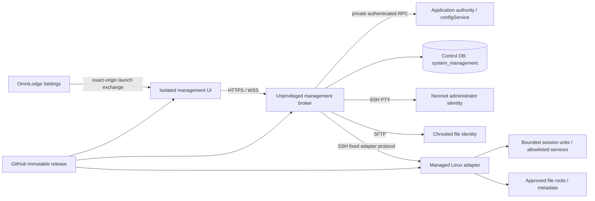

# System Management: architecture and complete delivery plan

Status: **implementation authorized on 4 November 2026; in progress**.

## Root filesystem extension requested on 4 November 2026

The administrator requested the real server filesystem rather than only the initial empty operations workspace. This explicitly expands file access to root-owned files; the earlier restricted-file-identity boundary remains the default for ordinary profiles.

- Add a default-off Control Panel switch, an explicit `rootFiles` role/host grant and an enrolled managed-host capability. Require the existing current global-administrator session and password confirmation. Configuration changes revoke old console sessions.
- Give each enrolled administrator a dedicated SSH identity and encrypted key for a fixed root SFTP gateway. It has no shell, forwarding or PTY. Serve the real `/` in a bounded transient service, with the filesystem read-only and only that actor's private staging bind writable. Do not reuse the maintenance SSH key.
- The read transport keeps only `CAP_DAC_READ_SEARCH`, uses private minimal devices, and masks `/proc` and `/sys`. Kernel virtual filesystems are outside Files. This prevents process-root magic links or raw devices from bypassing the read-only mount namespace. Ordinary server files, logs and backups remain readable across owners.
- Publish mutations through the signed, reviewed, journaled root adapter. Preserve existing destination ownership/mode. Keep deployment-controlled releases, dependency layers and host deployment tooling read-only through this interface. Preserve storage reserves, version checks, private-copy publication, trash and recovery rules.
- Show root access and the actual absolute path clearly. Support navigating a symlink to its canonical target without allowing mutation-path symlink bypasses. Do not silently change terminal execution identities.
- Provision only from the qualified immutable release, verify root-owned fixture reads, staging isolation, reviewed changes outside the operations workspace, protected deployment-path denials and revocation on real Linux before production activation. Test production only with owned temporary fixtures; never open or print real secret file contents.
- Enabling root browsing necessarily lets an authorized root administrator read sensitive server files, including configuration credentials. This is an explicit privileged mode, not the restricted workspace's original secret-isolation guarantee. Root writes still use the existing reviewed action flow.

Prepared: 4 November 2026. Repository baseline: `b0bd3dd4e615dec51a070e29ea123c51b06dae4c`. Planning branch: `codex/system-management-plan`.

## 1. Outcome and delivery boundary

Add **Settings → System Management**: a responsive administration workspace with a genuine interactive SSH terminal and an SFTP file manager. Administrators can connect to enrolled servers, run commands, manage files, edit text, transfer files, inspect services and logs, and trace administrative activity. Core terminal/file workflows should feel familiar to PuTTY and FileZilla users while working well on phones.

This document is the architecture and implementation contract. The planning task is complete. The user subsequently authorized implementation and production deployment on 4 November 2026. Subsequent development must deliver the complete agreed scope in one coordinated release. The workstreams below are implementation dependencies, not separate public releases or an unfinished MVP.

The product will complement Database Workspace and the existing release control plane. Database backup deletion/restoration remains in the existing backup workflow; application releases and rollbacks remain in the immutable GitHub Actions workflow. An SSH terminal operates with its remote operating-system account's actual permissions. A browser cannot turn an unrestricted root shell into a safely restricted shell by filtering command strings.

### Complete first-release scope

| ID | Capability | Required outcome |
|---|---|---|
| SM01 | Enrolled servers | Multiple named profiles, environments, separate terminal/file identities, verified host keys, connection tests, capability discovery, credential rotation, disable/revoke |
| SM02 | SSH terminal | Real PTY, interactive programs, multiple tabs, optional desktop split, resize, search, selection, copy/paste, font/theme, bounded scrollback, reconnect to a retained session |
| SM03 | Remote files | Navigation, breadcrumbs/path entry, hidden files, sorting/filtering, multiselect, metadata, mkdir, rename, copy/move, upload/download, supported permission changes |
| SM04 | Text editing | Bounded text preview, syntax highlighting, search, dirty state, save/save-as, encoding/newline preservation, external-change detection and conflict comparison |
| SM05 | Transfer queue | Files/folders, progress/rate, concurrency, per-item errors, eligible pause/resume, cancellation, retry/reconciliation, checksums and honest completion states |
| SM06 | Comparison and deletion | Folder comparison with previewed one-way copy plans; recoverable trash where supported; explicit permanent deletion elsewhere |
| SM07 | Services and logs | Allowlisted process/service status and actions, live bounded logs, search/pause/export, existing PM2 controls consolidated |
| SM08 | Host overview | Connection, CPU/RAM/disk/inodes, uptime, service health, current release, sessions/transfers, links to Database Workspace, backups and Maintenance |
| SM09 | Access and activity | Fresh global-administrator authorization, per-action/per-host grants, independent reauthentication, revocation, structured audit, controlled optional recordings |
| SM10 | Desktop and mobile | Usable standalone and embedded workspace, mobile terminal keyboard controls, touch file actions, accessible status/error/recovery flows |
| SM11 | Operational delivery | Isolated browser origin and broker, managed production adapter, enforced resource limits, durable operation journal, tested drain/recovery and immutable packaging |

Not included: FTP/FTPS, Telnet, serial ports, RDP/VNC, SSH agent forwarding, arbitrary SSH tunnels, an unrestricted browser root login, automatic OS/package upgrades, arbitrary scheduled shell scripts, two-way background synchronization, archive extraction, or replacement of the provider's emergency console. These are distinct products or operational capabilities, not prerequisites for the SSH/SFTP workflows above. Raw files are supported; archive extraction can still be performed deliberately in an authorized shell within that account's permissions.

## 2. Repository and infrastructure evidence

These observations describe the inspected baseline. Recheck operational facts before implementation and activation; capacity figures are not reservations.

| Existing part | Evidence and consequence |
|---|---|
| Settings shell | [SettingsLayout](../ui/src/pages/settings/SettingsLayout.tsx) special-cases only `/settings/sql-helper`. Add reusable wide-workspace handling for the new route. |
| Settings navigation | [AppNavbarSettings](../ui/src/components/navbars/AppNavbarSettings.tsx) needs a System Management entry. Group system administration links without changing business-module access. |
| Existing host controls | [SettingsLanding](../ui/src/pages/settings/SettingsLanding.tsx), [PM2 access](../ui/src/utils/pm2Access.ts), and [PM2 routes](../be/src/routes/pm2Routes.ts) already expose administrator-only logs/restarts. Migrate their behavior into this workspace and secure compatibility routes. |
| Release information | [SettingsMaintenance](../ui/src/pages/settings/SettingsMaintenance.tsx) already exposes release/migration information and workflow links. Reuse those contracts. |
| UI foundations | React 18, Mantine 7, React Router and CodeMirror are present. Reuse visual/editor foundations; isolate the terminal bundle from the main application's scripts. |
| WebSocket proxy | [UI server](../ui-server/server.js) sets `ws: true` for the existing API proxy and has a 120-second proxy timeout. This does not supply terminal authentication, lifetime management, or a dedicated management-origin route. |
| Main page CSP | [Reporting security](../ui-server/reportingSecurity.js) permits third-party resources. Terminal/editor/log content must use a separate minimal origin. |
| Authentication | [Auth middleware](../be/src/middleware/authMiddleware.ts) handles HTTP identity. Persistent sockets need their own continuing authority checks. Password verification exists in [configController](../be/src/controllers/configController.ts); a reusable step-up grant is new work. |
| Configuration | [appConfigRegistry](../be/src/config/appConfigRegistry.ts) and [configService](../be/src/services/configService.ts) own operational settings, encrypted secrets, actor/reason history and synchronization. Reuse them. |
| Durable operations | [Database Workspace services](../be/src/services/databaseWorkspace) provide useful access, review, journal, fencing, artifact and supervision patterns. SSH must have a separate runtime and identity. |
| Deployment identity | [Deployment SSH policy](../ops/production/ssh/90-omnilodge-deploy.conf) prohibits PTY and arbitrary commands. Never relax it or reuse its key for the terminal. |
| Production contract | [Production operations](../ops/production/README.md) and [Database Workspace operations](database-workspace-operations.md) require immutable releases and protected bootstrap secrets. |

The previous production verification found a small host with 2 GiB RAM, PostgreSQL 16, Ubuntu 20.04/systemd 245, and limited free disk. Database Workspace already has a separate bounded worker. The current application PM2 processes run with more privilege than the proposed broker should have. New services must be independently unprivileged and must not inherit the main backend environment or database superuser connection.

The existing independent `omnilodge_workbench_control` database is suitable for an additional isolated operational schema. It shares the PostgreSQL cluster: it is not protection against loss of the entire server or cluster. This feature remains dependent on healthy authentication and infrastructure; keep the existing external SSH/provider-console recovery path.

## 3. Architecture decisions

| Decision | Chosen approach | Reason |
|---|---|---|
| Browser origin | Proposed `https://system.omni-lodge.com` | Keep remote terminal output and file/log content away from main-app scripts, cookies and telemetry. DNS/TLS provisioning is future activation work. |
| Navigation | Main Settings route embeds the console; also offer standalone full-window mode | Preserve familiar navigation while giving terminals enough room and allowing browsers that block embedded sessions to use a top-level page. |
| Browser terminal | Locally bundled `@xterm/xterm`, fit/search and supported Unicode addons | Real terminal emulation, rather than rendering a command-output textarea. Pin tested versions in lockfiles. |
| Transport | HTTPS for control/files; authenticated WSS for PTY and log streams | Separate byte streaming from reviewed mutations and resumable file transfer requests. |
| Broker | Dedicated Node/TypeScript management server under an unprivileged Linux user | Reuse repository tooling while isolating SSH sockets, streams, buffers and secrets from application request workers. |
| SSH client | `ssh2`, mandatory host verification, no local shell subprocess for SSH | Supports SSH PTY/SFTP directly; private keys remain server-side. Test its pure-JavaScript path under production's dependency installation policy. |
| Managed host adapter | Small Go Linux executable, built in CI, with fixed typed operations | Descriptor-relative file handling and managed session/service operations need an explicit OS boundary. No compiler or package installation on production. |
| Remote identities | Separate per-administrator nonroot shell identity and SFTP-only identity on the managed host | App-user isolation must also exist in the OS. Separate SFTP confinement from interactive shell privileges. |
| Durable state | New `system_management` schema with separate authority and broker roles in the existing control database | Preserve operation IDs and outcomes without allowing the broker to forge authority records or use the application superuser pool. |
| Configuration | Existing Control Panel registry/service, including encrypted credential entries | One operational source of truth with existing authorization and audit. |
| Deployment | Same trusted release SHA/artifact for application, console, broker and adapter | Versioned protocols, reproducibility and rollback; no ad hoc uploads over live code. |

The management origin uses its own host-only cookie, CSP and static bundle. Do not share `Domain=.omni-lodge.com` cookies, application JWT secrets, third-party analytics, error-session replay, or service workers. Remote previews never execute HTML/JavaScript. This isolation reduces exposure to scripts on the main page; it does not make a compromised main backend trustworthy. The console independently reauthenticates before privileged access. [xterm.js security guidance](https://xtermjs.org/docs/guides/security/)



### Process boundaries

1. **Main backend authority:** authenticates existing users, resolves current action/host eligibility, owns Control Panel persistence, verifies password step-up, and issues/revokes bound grants. Its private authority listener uses a root-owned Unix socket directory, restricted socket access, authenticated request envelopes and nonce replay protection. It is not exposed through `/api` or the public proxy.
2. **Management broker:** serves the isolated UI and management API through a loopback-only ingress, validates the management session, performs fresh authority checks, owns SSH/SFTP transports, bounded stream buffers and transfer workers, and writes the operational journal. It receives only the credential needed for an authorized connection; it never receives `backend.env`, the config encryption master key or the application DB credential.
3. **Managed host adapter:** installed root-owned by the release control plane. It accepts a versioned, bounded protocol over a dedicated forced-command SSH identity. It has no TCP listener. Narrow sudo entry points permit only the fixed adapter binary; no arbitrary executable, path, environment, unit or shell argument may enter a privileged operation.
4. **Managed remote shells:** the forced-command gateway accepts the SSH PTY; the adapter launches the actual interactive shell with a fixed per-administrator nonroot identity in a recorded systemd unit. Those shell identities cannot authenticate directly through an ordinary SSH shell/exec path. Shell commands remain arbitrary within that OS identity. The adapter provides lifecycle/resource control, not a shell-language filter.
5. **SFTP subsystem:** a distinct `internal-sftp` identity with a root-owned chroot and approved mounted roots. For adapter-managed roots, it can read published files and write only its actor/job staging directories; only the adapter can publish, rename or delete destination entries. General writable roots, if explicitly enrolled, have weaker concurrency guarantees. No remote shell is available through the SFTP identity.

Privileged adapter requests also carry a short-lived signed authorization envelope from the authority service, bound to actor, target host, action, exact parameter digest, policy revision, operation UUID and expiry. The adapter pins the authority public key in root-owned bootstrap policy, validates its local action/identity/root ceiling, and durably consumes the nonce before a side effect. Possessing the transport key alone must not authorize arbitrary privileged operations. The signing key is not given to the broker; rotation and replay-ledger recovery are part of the host runbook. Root-owned host policy can only be widened through the trusted infrastructure workflow, never by a Control Panel value.

A separate `management-server/` package and `management-ui/` bundle are preferable to adding the terminal to the main SPA. Use a small Vite/React build for the isolated UI; compatible shared components must not import main-app initialization, analytics or session code. Keep new package scripts and lockfiles explicit. The Go adapter is confined to `ops/system-management/adapter/`, with its own pinned toolchain/module checksums and Linux tests. This additional language is justified by the privileged boundary; do not expand it into a second application backend.

## 4. Access, authentication and server enrollment

### Permissions

Initial eligibility mirrors current host/Database Workspace controls: **global `admin` / `administrator` accounts only**, plus explicit page/module/action and host grants. Ordinary Owner, Manager, Assistant Manager and product-scoped roles receive no system access automatically. A business role name containing “owner” or “admin” is not sufficient. If global Owner access is desired later, change the central eligibility policy deliberately rather than copying business permissions into host administration.

Add page `settings-system-management` and module `system-management`. Define actions: `view`, `connectTerminal`, `readFiles`, `writeFiles`, `deleteFiles`, `changePermissions`, `transfer`, `viewLogs`, `controlServices`, `runOperations`, `manageHosts`, `manageCredentials`, `viewActivity`, `viewRecordings`, `terminateOthers`.

Authority is the intersection of eligibility, action, host policy, selected identity, current configuration revision, and remote OS permissions. UI hiding is not authorization. Object IDs are bound to actor/host/session; never accept a browser-supplied username or arbitrary destination hostname in an operation request.

### Login and launch sequence

The current login token contains user ID without a stable server-side login-session record, and logout clears the browser cookie. That is insufficient for this design. Add application-owned login-session records with random `jti`, actor, expiry, revocation and security epoch; include `jti` in newly issued ordinary login JWTs. Logout revokes that record before acknowledging success; password reset/account disable revoke the relevant sessions. Fresh authority checks verify the parent record as well as current role/scope. Legacy tokens can retain ordinary application compatibility until expiry but must complete a fresh sign-in before launching System Management. Do not apply this full-session contract to limited receipt-access capabilities. Add regression tests for existing login/logout flows and document the one-time administrator sign-in requirement.

1. Settings requests a single-use launch grant after fresh main-app authorization. Store only its hash; bind actor, parent session, intended management origin, nonce, capability ceiling and expiry (30 seconds).
2. Deliver it via exact-origin `postMessage` with source-window checks and a handshake nonce, or an explicit POST for standalone launch. Never put it in a URL or persistent browser storage. No wildcard origin, generic postMessage RPC, or command injection through parent messages.
3. The broker redeems it once through the private authority channel, rechecks account state and creates a short-lived management session with `__Host-` Secure/HttpOnly cookie. Use Strict SameSite for the intended same-site origins; verify actual browser behavior. Failed iframe cookies lead to standalone mode, not weaker cookies.
4. The isolated origin requests password verification before the first terminal, file mutation, credential operation or service action. Reuse server-side password verification with rate limits; never retain the password. A successful check yields a 10-minute action-bound step-up lease, bound to management session, actor and policy generation. Viewing sensitive logs/files also requires a current management authentication lease.
5. Each socket attachment requires a separate single-use ticket valid for 15 seconds, bound to the session, actor, host and stream. Authenticate the upgrade cookie and exact Origin; transmit the attachment ticket as the first frame under a five-second deadline, before any SSH connection or sensitive stream is exposed. Do not place tickets in query strings or subprotocol/access logs.
6. Every new request/mutation and connection rechecks fresh authority. Active streams receive revocation events and revalidate at least every 15 seconds. Logout, account disable, scope/action loss, host disable, key rotation or expired maximum session duration stops further input and closes/cancels work according to its observed lifecycle.

The 15-second check is the maximum fallback revocation window, not immediate revocation. An unavailable authority service fails closed: reject new work, stop accepting terminal input/file publication immediately on a failed check, then close the session. A running shell may already have side effects. Ordinary step-up expiry locks new terminal input and new mutations pending reauthentication; output may be retained briefly within the existing session lease. Already accepted bounded structured jobs can complete only while their general authorization remains valid.

Fresh authority includes a known-current host/config revision. A stale cached allowlist or credential fallback must not restore access after a revoked configuration. Define idle time by meaningful user interaction, not server output, polling or heartbeats. Absolute lifetime still expires during activity. For a managed session, loss of authority schedules exact-unit termination; operations already completed are preserved as completed, not relabelled cancelled.

Apply CSRF protection and exact Origin checks to all mutating HTTP routes; cookie presence alone is insufficient. Bound message sizes/rates and disable WebSocket compression initially. Session checks, origin validation and message-level authorization are separate responsibilities. [OWASP WebSocket guidance](https://cheatsheetseries.owasp.org/cheatsheets/WebSocket_Security_Cheat_Sheet.html)

### Host enrollment

Host profiles contain stable ID, display name, environment, hostname, port, allowed resolved addresses/CIDRs, expected SSH host-key fingerprints, identity bindings, approved root IDs, capabilities, service IDs and credential references. They do not contain browser-editable arbitrary command templates.

The connection test has independent stages: DNS/address policy, TCP reachability, observed host key, trusted-key match, SSH authentication, PTY/SFTP/adapter availability, and resource/capability probes. Report the actual failing stage. First enrollment shows an observed fingerprint but **does not trust it automatically**. Require independent confirmation from the server/provider console or another trusted source, with actor/reason audit. A changed key blocks the connection until a reviewed rotation; a reconnect never silently accepts it.

Resolve and validate every connection, connect to that validated address, then verify the enrolled key. Block unconfigured loopback, link-local/metadata, multicast and private destinations. Intentionally managed internal/loopback hosts need explicit allowlisted entries; production can have one. Do not let browser input choose IPs, ports, proxy commands or alternate DNS targets. Bastions/ProxyJump are outside the first release.

Prefer dedicated Ed25519 keys. Support encrypted stored private keys/passphrases and stored passwords only where the host explicitly permits them; keyboard-interactive MFA and SSH-agent forwarding are outside this release. Credential entry is write-only in the management UI, with replacement/rotation rather than secret reveal. Do not import the existing deployment credential or an operator's private maintenance key. Plaintext is confined to authorized authority-to-broker delivery and necessary SSH-library connection memory; never persist or log it. Clear buffers where practicable, without claiming JavaScript can guarantee erasure of all copies. [ssh2 client API](https://github.com/mscdex/ssh2)

## 5. Remote privilege and filesystem model

### Real shell guarantees

On the managed production host, each eligible administrator has a provisioned nonroot execution identity. Authentication goes through a separate forced-command gateway with root-owned authorized keys; direct password/key authentication to the execution identities is disabled. The broker profile maps the application user to this identity. Changing mappings is privileged enrollment, not a regular profile preference. Generic hosts may explicitly use a shared identity, but must show that this gives no OS-level isolation between administrators.

Deny SSH forwarding, agent forwarding, X11, tunnels and user rc hooks at the transport policy. These options reduce protocol features; they do not stop an authorized shell from using ordinary network clients. A “read-only terminal” is not offered. Read-only users can receive file/log access without terminal access. [OpenSSH server configuration](https://man.openbsd.org/sshd_config)

Keep `/opt/omnilodge/releases`, activation pointers and their parent directories, `/etc/omnilodge`, deployment helpers, application credentials, PostgreSQL data, service definitions and executable search paths unwritable by all web-console identities. Production code/dependency/build changes remain outside operational writable roots. Do not install broad sudo access or membership in `docker`, `postgres`, `root` or equivalent privileged groups. This is an OS policy, not a hidden-file list.

Managed terminal sessions use root-owned unit names derived from operation UUIDs and a root-private registry mapping actor, host, UID and generation. Launch the fixed shell using a reviewed `systemd-run` invocation with a PTY, a fixed environment and resource properties. Stop requests reference a registered session ID, never a caller-supplied PID/unit. Closing the browser does not stop the unit until the configured grace policy; “Terminate session” stops that unit and its descendants. Limit guarantees require the deployed systemd/cgroup configuration to pass runtime probes. A process escaped through unrelated privileged services would invalidate the model, so accounts must not have those privileges.

Disable cron/at submission, lingering user services, writable service-launch paths and cgroup delegation for managed execution identities. The host keeps a root-owned watchdog and expiring remote execution lease, initially 60 seconds with signed renewals every 15 seconds while authority is valid, bounded by the session's absolute lifetime. A created session includes an idempotent stop capability limited to that exact unit. Expired renewal, broker death or authority outage must stop the managed unit without requiring a new authorization request to an unavailable backend. Preserve root-private nonce, generation and outcome journals through broker/adapter restarts. Reattachment can survive a browser disconnect while the broker is alive and continuing valid renewals; it cannot bypass lease expiry.

These timing guarantees are distinct: normal authorization detection/input blocking has a 15-second fallback; an orphaned remote session can remain alive until its 60-second execution lease expires. With watchdog checks every five seconds and a five-second TERM-to-KILL deadline, the initial healthy-host termination budget is 70 seconds after the last valid renewal. Show and test the effective limits. A failed host/kernel cannot provide a hard real-time termination guarantee, and stopping a process does not undo its completed effects.

Generic SSH sessions can close the SSH channel but cannot guarantee detached children stopped. Label this limitation and never report all processes terminated without verification. Broker resource limits do not constrain remote programs; managed remote units have separate aggregate and per-session ceilings. No root web shell is enabled by profile configuration in this release.

### File roots and path handling

For the managed host, publish explicit file roots such as an operational work directory, approved upload directories, and selected read-only log/release views. Root IDs map to root-owned host configuration. Configured scopes may narrow those roots but may not widen OS policy. Avoid exposing the entire `/` tree as writable.

For confidential paths, enforce read denial as well as write denial. Backups and their credentials are not ordinary writable SFTP content. Provide **Open in Database Workspace backups** for verified download/delete/restore workflows, preserving that system's permissions and audit. Do not expose `/home/postgres/backups` as a route around those controls.

All paths remain structured data; never construct `sh -c`, `scp`, `cp`, `rm`, `chmod`, `tar` or `systemctl` command strings from file names. UI entries carry opaque root/path tokens. Validate raw byte length, separators and traversal server-side. Render names as escaped text, including spaces, quotes, newlines and bidirectional Unicode. Support arbitrary filename bytes through opaque IDs where needed; if a filename cannot be represented for editing, allow safe ID-based download and explain the limitation rather than silently changing it.

Managed adapter file operations open roots once and traverse relative to directory descriptors. Refuse symlink traversal, special files and unauthorized mount transitions; validate regular-file identity and hardlink policy. Use `openat2` resolution constraints when available; Ubuntu's actual kernel must be probed. An older-kernel fallback requires an independently tested descriptor walk plus the enforced filesystem namespace boundary; otherwise disable that managed operation. A preceding `realpath` check alone is not sufficient. [Linux openat2 documentation](https://man7.org/linux/man-pages/man2/openat2.2.html)

For generic SFTP, the remote account must enforce confinement. A UI root list is a navigation aid, not a defense against server-side symlink/rename races. Follow a visible symlink only when the profile permits it and the destination is within the remote OS boundary; default to showing link metadata without traversal. The generic profile must describe its weaker capabilities. `internal-sftp` can enforce a restricted subsystem, but requires correct server/chroot ownership and configuration. [OpenSSH SFTP server](https://man.openbsd.org/sftp-server)

## 6. Terminal behavior and protocol

Provide multiple named tabs with independent immutable host/account identity; optional two-pane split on desktop. Switching the workspace host never retargets an existing terminal. Users can rename tabs, maximize, search scrollback, change font size/theme and close explicitly. Session creation supports a predefined home/work root, not an arbitrary environment or privileged working directory.

Use `xterm-256color`, UTF-8, proper PTY resize and bidirectional bytes. Test shell prompts, `less`, `top`, `vim`, Ctrl+C, Ctrl+D, job control and alternate screen. Terminal initialization and resize bounds reject absurd dimensions. Preserve bytes across UTF-8 boundaries; do not treat each WebSocket frame as an independent decoded string.

The WSS protocol is versioned and distinguishes `attach`, `input`, `output`, `renderAck`, `resize`, `heartbeat`, `lease`, `state`, `error`, and `exit`. Every message is bound to one session generation. Input sequence ACK means accepted for forwarding, **not executed by the shell**. Reconnection never replays unacknowledged input; ask the operator to inspect the terminal state.

Each terminal has exactly one input-owning attachment. A second tab offers an explicit takeover, which increments the attachment generation and fences the old connection. Only the current owner can send input or resize the PTY. Replayed frames from an earlier attachment are rejected even if its socket is still open. This prevents split views or duplicate browser tabs from interleaving commands accidentally.

Output has sequence numbers and a bounded ring buffer. Browser rendering ACKs advance the flow window. Propagate backpressure through the broker into the SSH stream; cap client and server buffered bytes. Output flood must not exhaust RAM or indefinitely block control/interrupt frames. Search only retained scrollback; show a marker when output was truncated. xterm's asynchronous rendering requires an explicit producer/consumer flow-control design. [xterm.js flow control](https://xtermjs.org/docs/guides/flowcontrol/)

States: `connecting → active → detached → active`, or `closing → closed`; also `locked`, `host_key_changed`, `transport_lost`, `expired`, and `failed`. Retain a still-live SSH session for 120 seconds after browser transport loss. Reattachment requires fresh authorization and the same actor/session generation. A broker crash, dead remote connection or drained release cannot be resurrected from database metadata; show **Session ended; start a new session**. Detached remote process uncertainty remains visible for generic hosts.

Reconnecting the existing renderer can resume from its acknowledged output sequence while the required bytes remain retained. A fresh renderer after reload cannot reliably reconstruct a terminal screen from a truncated ANSI ring. The first release must show **Session reattached; earlier screen state is unavailable** in that case, present a separately labelled retained-output transcript, and let the user request the running application's redraw themselves. Do not automatically send Ctrl+L or other input, or replay an arbitrary partial escape stream as if it were a complete screen snapshot. A buffer gap similarly requires explicit incomplete-view handling.

Clipboard is explicit. Ctrl+C interrupts when no selection exists; Copy selection is a separate action and shortcut. Preview multiline paste and large paste; bracketed paste where supported is helpful but does not guarantee commands cannot execute. Disable OSC52 clipboard writes and automatic file-download/URL actions. Safe HTTP(S) links need a user gesture and `noopener`; never permit `javascript:`, `file:` or terminal-driven navigation. Browser console logs and application telemetry must not capture input/output.

Use ping/pong keepalives and an idle policy; don't assume an indefinitely stable Cloudflare connection. Cloudflare can close WebSockets during infrastructure updates, and WAF inspection of the upgrade does not validate later frames. [Cloudflare WebSockets](https://developers.cloudflare.com/network/websockets/)

## 7. File manager, editor and transfers

### Browsing and actions

Desktop: remote tree/roots, breadcrumb plus editable location, virtualized file list, optional second remote pane or **Local selection** pane, and a collapsible transfer queue. Columns: name, type, size, modified time, permissions and owner where available. Sort/filter on all loaded inventory, with explicit server-side/incomplete-inventory status for large directories. Do not present a filtered first page as a complete directory search.

Use cursor-based enumeration jobs and bounded result storage for large directories. Directory changes can invalidate a snapshot; expose refresh and stale-item errors. There is no guaranteed consistent recursive snapshot on generic SFTP. Size and timestamp formatting is presentation only; identities use raw values and host information. Directory sizes are calculated on request with bounded traversal, not automatically for every row.

Actions: create directory, rename, copy/move, upload, download, view/edit text, inspect permissions and delete. Same-filesystem moves may use rename; cross-filesystem moves are explicit copy → verify → delete jobs with separate outcomes. Generic same-host copy streams through the broker if no server-copy extension exists. Cross-host copy is excluded initially; administrators can download/upload through the supported queue. Changing file mode is limited to allowed owner bits; no setuid/setgid/sticky changes or arbitrary chown in the general file dialog.

The device pane can see only user-selected files/directories. Use File System Access APIs when supported and permissions are granted; provide ordinary file input, folder-upload and streamed browser-download alternatives. Do not claim unrestricted local-disk browsing, durable browser permissions, or reliable background execution on a phone. [File System API](https://developer.mozilla.org/en-US/docs/Web/API/File_System_API)

### Text editor and conflict contract

Use CodeMirror with lazy language support for text, JSON, YAML, shell, SQL, JavaScript/TypeScript, Markdown and common configuration formats. Default editable limit: 2 MiB. Show encoding, newline convention, original byte size, remote timestamp and a dirty indicator. Preserve UTF-8/BOM and CRLF/LF; mixed line endings require an explicit normalization choice. Invalid UTF-8 is initially read-only with download available; do not silently replace bytes. Binary/large files show metadata and download, not an attempted text render. Do not execute Markdown/HTML previews.

Opening captures identity, size, modification time and SHA-256 for editable files. Saving creates a job-owned temporary file on the destination filesystem, verifies length/hash, then rechecks the original version before publication. Managed roots use a separate protected staging area; generic SFTP may use an exclusive temporary sibling. On conflict: compare original/current/proposed, reload, save-as, or explicitly approve overwrite of the newly observed version. Never silently overwrite just because the editor was open first.

**Concurrency guarantee:** the managed adapter serializes its own competing writes to a path with a durable generation/fence and performs publication through open directory handles. This does not provide universal atomic compare-and-swap against an unrelated process editing the same file. Generic SFTP also has a race between checking and replacing. Both must disclose this when files are shared with external writers. For strict exclusive management, use an adapter-owned directory writable only through its operations; otherwise prefer save-as during uncertainty. Atomic rename prevents partial content, not stale overwrite. Do not market either property as the other. [ssh2 SFTP API](https://github.com/mscdex/ssh2/blob/master/SFTP.md)

### Transfer pipeline

1. Create an actor/host/root-bound transfer with idempotency key, source metadata, destination intent, conflict policy and capacity reservation. Expand folder manifests incrementally; no unbounded list in a single request.
2. Upload browser files in bounded 4 MiB HTTP chunks, below ingress body limits. Broker streams into an exclusive random job-owned temporary file over SFTP, preserving confirmed offsets. For managed roots this is an actor/job staging directory on the destination filesystem, with published directories unwritable by the SFTP identity. The adapter validates the completed staging descriptor/identity and makes a private publication copy inaccessible to the uploader, verifying its expected digest/length before publication. Changing ownership or mode alone does not revoke an already-open writable descriptor. Reserve space for both copies unless the host provides an independently verified equivalent writer-exclusion mechanism. Generic roots may use a temporary sibling. No complete upload is buffered in RAM or staged in the broker's working directory by default.
3. Enforce byte/file/depth/concurrency limits throughout, not only at admission. Track remote free space/inodes where supported. Unknown remote capacity is displayed; never fabricate free space. Reserve headroom on the actual destination filesystem, accounting for existing files, temporary copies, trash and concurrent jobs.
4. Verify bytes/offsets and a stream SHA-256. A broker-side digest only proves the bytes streamed, not an independent read-back of remote content. Use the managed checksum helper or a bounded SFTP read-back for full verification; otherwise label the weaker verification accurately.
5. Before publication, freshly reauthorize, recheck target identity/conflict policy and source completeness. Use supported atomic rename/fsync behavior. If the host lacks the required extension, explicitly report non-atomic publication capability; do not silently fall back for an overwrite requiring atomic replacement.
6. Record final identity/hash/outcome before removing a temporary file. Lost acknowledgement during publication becomes `reconciling` or `outcome_unknown`; do not automatically upload again or delete the destination.

Managed publication/move/delete requests must validate the current remote operation fence under the adapter's per-path lock, reject stale generations and retain idempotent outcomes in the host journal. A database lease alone cannot fence a process already connected over SFTP. For generic SFTP, never reassign/retry an uncertain writer until the prior transport is confirmed ended and the destination reconciled; when that cannot be established, retain `outcome_unknown` for explicit investigation. Do not claim the managed fencing guarantee on general writable roots.

Queue states: `queued`, `planning`, `waiting_for_source`, `transferring`, `paused`, `verifying`, `awaiting_conflict`, `publishing`, `completed`, `partially_completed`, `cancel_requested`, `cancelled`, `failed`, `reconciling`, `outcome_unknown`. Persist per-file status. A folder job can partially succeed; retries apply only to verified failed/incomplete children.

Pause/resume is capability-dependent. Resume verifies file identity, confirmed length and chunk digests; truncate/reconcile an uncertain trailing chunk before continuing. A page reload may require selecting the same source again; name/size/mtime alone do not prove it is the same file. Do not resume stale content into a changed destination. Cancelling removes only that job's known temporary objects, with cleanup outcomes recorded. Never remove an unrelated file with a matching name.

Downloads use streaming to a user-selected file writer where supported; otherwise stream an authenticated attachment to the native browser download manager without creating a multi-gigabyte Blob. Completed writer closure can be reported as **Saved**. A native download handoff is reported as **Download handed to browser**, not proof that the file reached disk. Download authorizations are opaque, actor-bound and short-lived; no filesystem paths or credentials in URLs. Large downloads support validated byte ranges where safe, with source-version checks.

Folder downloads use a user-selected directory writer when supported, with per-file outcomes. Otherwise generate a streaming ZIP64 archive from a bounded manifest without staging the entire archive on the broker disk. Archive creation is included; archive extraction remains excluded. Validate entry names against traversal, duplicates and encoding collisions. Check source identity before/after each read. A changed, unreadable or cancelled item makes the folder result incomplete: include an error manifest if the stream can finish, or report the interrupted archive without claiming success. Native download handoff still does not prove the archive was saved. Resume of a generated archive requires a reproducible snapshot; otherwise restart is explicit rather than serving unsafe byte ranges.

### Comparison, trash and recovery

Folder comparison offers left-to-right or right-to-left **copy plans**, initially based on name/size/mtime with optional content hashes. Show identical/newer/different/unknown and total planned bytes. Default to no deletion. The reviewed plan binds source and destination snapshots, conflict policy, roots and config revision; recheck changed items at execution. No hidden continuous sync, guessed timezone comparison, or automatic reverse deletion.

Managed roots can support trash: an atomic same-filesystem rename into a protected per-root trash directory with original identity/path, actor, reason, expiry and restore metadata. Enforce trash capacity and expiry. Trash is unavailable for protected data, unsupported roots or a cross-filesystem move; then the action is clearly **Permanently delete**. Restoring never silently overwrites a newly created destination. Recursive operations have bounded manifests, no symlink following, and per-item results. Purging requires fresh authorization and reviewed scope. Trash is not a backup.

## 8. Overview, services, logs and structured operations

Overview shows server/environment, fingerprint, connected identity, capability state, uptime/boot identity, sampled CPU/RAM/disk/inodes, current release, service health, active sessions and transfers. Metrics are timestamped; missing or stale data is labelled **Unavailable**/**Last updated**, never zero. Use structured read-only probes or adapter JSON, not locale-dependent parsing of arbitrary command output.

Services & Logs replaces duplicated Settings Landing PM2 controls. Approved service IDs map to root-owned adapter definitions for the backend, UI server and management broker, with exact executable paths and fixed argument sets. Status/logs/restart are first-release operations. Reboot/shutdown and arbitrary service installation/configuration are excluded. The PostgreSQL service is visible but not restartable through the initial UI. Broker restart has an explicit expected-disconnection state and a control-plane recovery path.

Every service action shows target/environment, impact, active sessions/jobs, reason and expected recovery. Record an accepted operation ID before starting. State progresses through `accepted`, `running`, `reconnecting`, then independently verified `healthy`, `failed` or `outcome_unknown`. An HTTP connection closing is not proof a restart failed. Do not blindly retry it.

Structured operations include connection tests, bounded diagnostics, service restart, log export, and cleanup of the management service's own expired temporary files/trash/recordings. Each has a fixed operation ID, schema-validated typed parameters, deadline, output bound and idempotency/reconciliation rules. There is no administrator-editable privileged shell-script field. Ordinary free-form commands belong in the SSH terminal and have different audit semantics.

Logs are allowlisted by service/source ID. They support tail/follow, pause, search within retained content, level/time filters where structured, line wrapping and bounded export. Escape output; remove unauthorized paths and known secrets in structured application log sources, without promising perfect redaction of arbitrary logs. Log rotation is a visible transition. Paused clients cannot accumulate unbounded buffers. Reading logs and exporting them are auditable capabilities.

Old PM2 endpoints must use the same eligibility/action/step-up/audit policy or be removed with migrated callers. Leaving an old less-restricted restart endpoint defeats the new design. Maintenance/release/rollback links use the existing control plane; the new service does not execute `git pull`, run builds on production, or activate manually uploaded release content.

## 9. Responsive UX and accessibility

### Information architecture

Settings entry opens a persistent header: **environment badge · server · remote identity · connection state**, plus host selector, Connect/Disconnect, full-window control and an activity indicator. Tabs: **Overview / Terminal / Files / Transfers / Services & Logs / Activity**. Host and credential administration is a distinct privileged entry, not mixed into routine file actions. Keep destructive controls away from Connect and navigation.

Desktop (≥1024 px): wide workspace, resizable panes with persisted non-sensitive layout, terminal tabs, optional two-terminal split, remote tree/file table and collapsible queue. Tablet: one primary pane and temporary sidebar. Phone: one active view, sticky identity header and bottom navigation for Terminal/Files/Transfers; other tabs remain available through a labelled menu. Do not compress a desktop dual-pane file manager into two unreadable mobile columns.

### Mobile terminal

- Fit the prompt above the software keyboard with dynamic viewport/`visualViewport` sizing; preserve scroll position on rotation.
- Provide 44 px touch controls for Esc, Tab, Ctrl, Alt, arrows, Copy, Paste and Interrupt; secondary controls for Home/End/Page Up/Page Down.
- Modifier buttons visibly arm once and reset predictably; provide an explicit lock mode only if tested.
- Respect IME composition. Do not transmit intermediate composed characters as independent commands.
- Selection, scrolling and terminal input modes must be distinguishable. Opening a menu must not send accidental keystrokes.
- iOS/Android backgrounding may suspend the browser; apply the same honest disconnect/reattach contract as desktop.

### File/mobile interactions

Use bottom sheets for item actions, an explicit multiselect mode, inspectable long filenames/full paths, compact metadata cards and a persistent transfer count. A file editor opens full-height with a sticky Save/Close bar. App-controlled closes and navigation prompt before discarding dirty content. Browser unload protection is best effort: crashes, mobile process kills and external navigation can lose unsaved drafts. Keep drafts in memory across step-up/reconnect; clear them on logout/revocation and do not persist sensitive content in browser storage by default. File-transfer status survives UI navigation via durable IDs, not a modal that must remain open.

Empty/error states distinguish not configured, unauthorized, unreachable, host-key mismatch, authentication rejected, SFTP unavailable, protected path, source changed, disk full, expired access and unknown outcome. Give one concrete next action. Do not reduce all failures to “Something went wrong.”

Use keyboard navigation, semantic labels, visible focus, screen-reader terminal mode, adequate contrast, reduced motion and status text in addition to color. Prefer neutral application typography outside monospace terminal/path/editor areas. Validate at 1440, 1024, 768, 390 and 360 px, including actual iOS Safari and Android Chrome; desktop emulation alone is insufficient for keyboard/clipboard/file-picker acceptance.

## 10. Control Panel configuration

Register a new **System Management** category. Every key needs label, help text, type/schema, safe default, scope/impact, validation and whether a change is live, invalidates review, drains sessions or requires infrastructure activation. Use `configService` refresh/invalidation; connection managers are a structured UI over these entries, not another settings table.

| Key (proposed) | Initial default / validation | Effect |
|---|---|---|
| `SYSTEM_MANAGEMENT_ENABLED` | `false` until all activation gates pass | Stop new admission immediately; active-session policy shown explicitly |
| `SYSTEM_MANAGEMENT_HOSTS` | Versioned JSON, empty profiles, ≤20 hosts | Host/IP/port/key/identity/root/service/capability schema; review and connection generations invalidated on change |
| `SYSTEM_MANAGEMENT_CREDENTIALS` | Secret JSON map, empty; encrypted, non-revealable | Write-only credential IDs/revisions; rotate/revoke related transports; no values in ordinary host responses |
| `SYSTEM_MANAGEMENT_HOST_GRANTS` | Versioned JSON, explicit actor/role/action/host intersections | Narrow only the global eligibility boundary; live revocation |
| `SYSTEM_MANAGEMENT_SESSION_POLICY` | Step-up 600 s; idle 900 s; absolute 7200 s; detach grace 120 s; authority check ≤15 s; remote lease 60 s with 15 s renewals | Durations bounded by host-enforced maxima; security reductions apply live; report watchdog/stop deadline separately |
| `SYSTEM_MANAGEMENT_TERMINAL_LIMITS` | 2 sessions/actor, 4 total; 10,000 scrollback lines; 2 MiB output ring/session; 64 KiB input frame | Bound all sessions including detached ones; no unbounded output |
| `SYSTEM_MANAGEMENT_TRANSFER_LIMITS` | 2 active streams total, 1/actor; 4 MiB upload chunks; 10 GiB max file; 10,000 files/job; depth 32 | Stream large data; enforce per-root capacity independently |
| `SYSTEM_MANAGEMENT_FILE_POLICY` | 2 MiB editable file; 100,000 entries/inventory; strict mode defaults | Review invalidation on root/policy changes; oversize directories need scoped navigation |
| `SYSTEM_MANAGEMENT_STORAGE_POLICY` | Broker artifact quota 128 MiB; min free reserve max(1 GiB, 15%) plus remaining reservations; trash 256 MiB/root | Target-filesystem admission; no quota override to make a failed write appear safe |
| `SYSTEM_MANAGEMENT_RETENTION` | Activity 90 days; completed transfer metadata 30 days; temp 24 h; trash 7 days; recordings 7 days | Scheduled bounded cleanup, held/active items excluded; expose cleanup status |
| `SYSTEM_MANAGEMENT_RECORDING` | `false`; if enabled, 10 MiB/session, 64 MiB aggregate encrypted quota | Explicit banner and separate recording access; never ordinary telemetry |
| `SYSTEM_MANAGEMENT_SERVICE_POLICY` | Approved service IDs and permitted actions, empty until provisioned | Can narrow root-owned adapter definitions, never invent arbitrary root commands |
| `SYSTEM_MANAGEMENT_BROKER_BUDGET` | Memory 256 MiB, CPU 25%, Tasks 64, file descriptors bounded | Infrastructure ceiling checked; apply through drain/restart, report effective limits |
| `SYSTEM_MANAGEMENT_REMOTE_BUDGET` | Aggregate 256 MiB/25% CPU/64 tasks on initial managed host; per-session within aggregate | Enforced on remote session units, not just the broker; capability tests required |

These are conservative starting policies, not claims the current small server can run every workload concurrently. Measure combined application, PostgreSQL, Database Workspace, broker and remote-session memory under load. Admission may allow fewer concurrent sessions/jobs than configured when capacity is insufficient. Temporary-file, trash and recording quotas also consume disk reserve; quota checks must share reservations across workers.

Credentials as an encrypted JSON entry must support atomic compare-revision updates, masked public metadata and per-entry change audit without leaking old/new secret values. If the existing config API needs structured secret patch support, extend that system; do not create a parallel credential table. Configuration changes are validated before saving and fail closed on malformed profiles.

Infrastructure/bootstrap exceptions: management hostname/ingress listener, authority Unix socket, restricted control DB URL, private broker identity material, artifact encryption key, OS users/chroot mounts and root-owned adapter policy. They must exist before config/auth can start and therefore live in root-owned bootstrap configuration. Explain these exceptions in the runbook. Console operational values remain in Control Panel. The broker's bootstrap file is separate from `backend.env` and contains only the minimum required secrets.

## 11. Durable model, API and error contracts

### Control schema

| Entity | Required fields and invariants |
|---|---|
| Application `auth_sessions` | Parent login `jti`, actor, expiry, revoked time/security epoch; application-authority owned, never broker-writable |
| `management_sessions` | Opaque ID, actor/parent-session reference, host/config generation, auth/step-up expiry, revoked time, release ID; token hashes only |
| `launch_grants`, `attach_tickets`, `operation_reviews` | Hashed nonce, actor/session/host/action binding, exact payload digest, expiry, consumed time; atomic one-use consumption |
| `terminal_sessions` | Actor, host/identity, broker generation, remote unit identity if managed, state, last ACK/heartbeat, expiry/exit reason; no serializable “live socket” fiction |
| `operations` | UUID, idempotency key, action, actor, reason, policy revision, reviewed scope digest, lease/fence, state, result identity, uncertainty and timestamps |
| `transfers`, `transfer_items` | Parent/item IDs, raw source/destination identity, confirmed offsets/chunk hashes, reservation, expected version, publication phase, cleanup/outcome |
| `file_versions`, `trash_entries` | Original identity/hash/path token, published generation, expiry, restoration outcome; never a substitute for a real backup |
| `artifacts` | Encrypted object path, owner/scope, size/hash, expiry, lease, recording/export kind; unavailable after authority loss |
| `audit_events` | Actor, host/identity, session/operation, action, reason, redacted summary, result, timestamps and related event IDs |

Authority-owned tables include management identity/step-up/authorization epochs, launch grants and approved operation scopes. Give the authority a separate restricted DB role; the broker's journal role cannot insert/update those records or manufacture successful authentication. Any broker-owned attachment record also requires an independently validated authority decision. Migration ownership is separate from both runtime roles, with no PUBLIC access or privilege-grant capability.

Use database constraints for idempotency and phase transitions, transactional nonce consumption, and leases with monotonically increasing fences. Remote managed mutations additionally enforce those fences in the adapter journal; generic SFTP does not. Recovery checks remote identity before continuing an interrupted transfer. Credentials/configuration do not live in these tables. Preferences may retain theme/layout/favorites, but never host authority, secrets, commands or terminal scrollback in localStorage.

Byte counts and offsets use decimal strings on the wire where they may exceed JavaScript's safe integer range. UTC timestamps include explicit offsets and are displayed locally. Distinguish unknown exit status, not-started, cancelled and nonzero exit. Shell keystrokes do not produce trustworthy per-command exit codes; structured operations do.

### API surface (proposed)

| Surface | Contract |
|---|---|
| Main `/api/system-management/capabilities` | Current eligibility and launch availability; no remote content or secrets |
| Main `POST /api/system-management/launch` | One-use launch grant; fresh authorization and CSRF |
| Private authority RPC | Redeem, reauthenticate, check/revoke, resolve approved connection, config revision; authenticated Unix transport only |
| Console `POST /management/session/redeem`, `/step-up`, `/logout` | Host-only management session lifecycle; no reuse of main app JWT in the console |
| Console `/management/hosts`, `/:id/test`, `/capabilities` | Redacted profiles and staged connection test; mutations route through configService |
| Console `/management/terminals`, `/:id/attach-ticket`, `/:id/terminate` | Create/attach/close exact actor/host/generation; no arbitrary socket destination |
| Console `WSS /management/stream` | Authenticated cookie + exact Origin + first-frame ticket; bounded versioned PTY/log frames |
| Console `/management/files/list`, `/stat`, `/content` | Root/path tokens, bounded inventory/read, version metadata; no caller-selected server-side absolute file path |
| Console `/management/file-operations/review`, `/execute` | Exact reviewed rename/move/delete/permissions/save scope; 60-second review TTL; fresh execution checks |
| Console `/management/transfers`, `/:id/chunks`, `/pause`, `/resume`, `/cancel`, `/reconcile` | Idempotent manifests and offsets; explicit publication state and conflict decisions |
| Console `/management/downloads` | Actor-bound streaming response/range policy, source identity; browser completion semantics distinguished |
| Console `/management/services`, `/logs`, `/operations/review`, `/operations/execute` | Typed allowlisted actions, bounded outputs, durable operation IDs |
| Console `/management/activity`, `/recordings`, `/health/ready` | Scoped cursor pagination, separate recording grants, readiness without secrets |

Exact route spelling can follow repository conventions during implementation; the trust boundaries and bindings are mandatory. HTTP responses use stable error codes: `FORBIDDEN`, `STEP_UP_REQUIRED`, `HOST_KEY_UNTRUSTED`, `HOST_KEY_CHANGED`, `HOST_UNREACHABLE`, `AUTH_REJECTED`, `CAPABILITY_UNAVAILABLE`, `PROTECTED_PATH`, `VERSION_CONFLICT`, `SOURCE_CHANGED`, `CAPACITY_EXCEEDED`, `LEASE_EXPIRED`, `REVIEW_EXPIRED`, `OUTCOME_UNKNOWN`, `DRAINING`. Include a user-safe explanation, correlation/operation ID and retry eligibility, not raw connection secrets or privileged command lines.

### Audit and recording

Always record session connect/disconnect/termination, host-key/config changes, credential revision changes, file/transfer operations and structured service actions. An accepted mutation must have a durable audit intent before execution; if journal capacity is exhausted, stop admitting new work. High-volume events are bounded and coalesced without losing mutation outcomes.

Do not claim terminal keystrokes are a per-command audit: editing, nested shells and scripts invalidate that assumption. By default record metadata only. Optional recording captures the output stream, not a separate raw input-key log; echoed secrets can still appear. Require explicit session notice, encryption, retention and separate viewing/export permission. If recording fills its quota, show the event and stop recording according to policy without silently claiming a complete transcript. No general error tracker/session replay receives terminal bytes, file contents, passwords or recordings.

## 12. Runtime operations and release integration

### Resources and recovery

Broker runs as a dedicated systemd service with minimal environment, private runtime directory, read-only release code, no extra capabilities, no-new-privileges and an explicit writable artifact directory. Use enforced cgroup limits and check them on the actual Ubuntu/systemd version; a unit file containing a setting is not proof it is effective. SSH network egress is limited to enrolled destinations as far as the host firewall supports; application checks remain mandatory.

Use separate connection/stream queues, bounded buffers and cancellation deadlines. A single fast `yes` process, huge directory or slow browser must not block unrelated management control requests or ordinary OmniLodge traffic. Avoid duplicate complete file copies on the small server. Recovery timers reconcile stale leases, temp files and remote operation states with strict ownership checks. Cleanup never recursively deletes a computed arbitrary path.

The broker is independently supervised, not a subprocess inheriting all main-backend secrets. Its readiness binds release/protocol version, authority connectivity, control migration version and effective resource enforcement. Admission can be disabled while the business application remains healthy. If System Management is configured enabled but its new release is incompatible or unhealthy, the release activation must not silently declare the feature healthy.

### Complete release procedure

1. Run the full implementation acceptance matrix below, build all artifacts in CI and stamp the same trusted master SHA into UI, broker and adapter. Scan dependencies and output for accidental secrets/source-map exposure.
2. Extend release packaging/validation for `management-ui`, `management-server` and the Linux adapter. Validate no path overlap with existing UI/backend artifacts, binaries match the supported architecture, and offline install/start requires no build scripts on production.
3. Rehearse on disposable Linux with the production-compatible systemd/OpenSSH setup, including the effective cgroup mode. Test bootstrap plan/apply idempotency and partial-failure recovery.
4. Before state migrations, verify both application and independent control backups using the existing backup mechanism. Add `system_management` to control backup/restore coverage and retain encryption material separately. A server dump and a Drive copy are distinct records; do not change their existing retention semantics.
5. Apply additive control migrations, provision restricted DB role, broker service, SSH identities, root-owned adapter policy, file namespaces and proposed management DNS/TLS/ingress through reviewed infrastructure changes. Do not copy operator/deploy keys or relax the deployment SSH account.
6. Candidate readiness validates broker/adapter protocol and isolated static bundle. No arbitrary remote commands run from a deployment health check. A dedicated harmless managed fixture can validate PTY/SFTP capability with bounded cleanup.
7. Drain old sessions: stop new admission, notify users, finish or pause transfers at safe checkpoints and close PTYs after the advertised grace period. Persist uncertain publication states before replacing the broker. Never silently replay shell input or resume a write because a new version starts.
8. Activate through the existing GitHub Actions control plane, then validate public management-origin TLS/CSP/cookies/WSS, business readiness, real host-key checking and the administrator flows. Keep System Management admission disabled until all required gates pass.
9. Rollback uses the existing release mechanism with backward-compatible control migrations. Old code must reject unknown state/protocol versions rather than interpreting them incorrectly. Preserve journals and partial files for reconciliation. Root-owned adapter/bootstrap changes need an explicit compatible rollback path; application rollback alone does not revert host configuration.

Candidate brokers use separate sockets, runtime directories, identity/generation and non-public ingress. They cannot claim active transfer leases, run cleanup/recovery loops, renew remote execution leases or adopt live session ownership. Candidate probes are restricted to their disposable fixture. Only explicit activation acquires the active supervisor generation. Adapter compatibility covers its root-private nonce/fence/outcome journal and live-unit ownership as well as protocol messages; rollback must never reset replay protection or install code unable to manage existing units.

No production `npm run build`, ad hoc `git pull` deployment, committed build/dist output, mutable live release editing, or terminal-driven bypass of immutable activation. New code paths must be added to workflow change detection and artifact verification, not just the UI navigation.

### Operational runbooks to deliver with implementation

- Host enrollment, independent fingerprint verification, identity provisioning and key rotation.
- Start/disable/drain, terminate exact sessions, reclaim abandoned jobs and inspect effective resource limits.
- Disk/inode pressure, quota exhaustion, partial transfers, file conflicts and unknown mutation outcomes.
- Broker crash, authority/DB outage, Cloudflare reconnect and release rollback.
- Control-store/recording encryption backup and recovery; external recovery when the web console is unavailable.
- Safe service/log administration and boundaries of immutable releases, application secrets and database backups.

## 13. Implementation workstreams and repository map

These workstreams may have multiple local commits. They ship together only after all SM01–SM11 gates pass. Later authorization controls when a branch is pushed, a PR is opened and production is deployed.

| Workstream | Deliverables | Dependencies |
|---|---|---|
| W0: contracts and harness | Final schemas, error/protocol types, host threat model, Linux/OpenSSH fixtures, interaction wireframes | This plan |
| W1: authority and config | Registry entries, host/secret UI, grants, password step-up, one-use launch/attach/review tickets, private authority RPC | W0 |
| W2: runtime and adapter | Isolated origin/bundle, rootless broker, control schema, managed SSH/SFTP identities, Go adapter, resource and path boundaries | W0, W1 |
| W3: terminal | PTY transport, flow control, reconnect, tabs/split/search, mobile keyboard, session revocation | W1, W2 |
| W4: files and transfers | Inventory, editor/conflicts, uploads/downloads, verification, queue/resume/reconcile, compare/trash | W1, W2 |
| W5: operations | Overview, allowlisted services/logs, durable operations/audit, optional recordings, migrate PM2 callers | W1, W2 |
| W6: responsive integration | Settings navigation, wide shell, full-window fallback, accessibility, end-to-end workflows | W3–W5 |
| W7: release and acceptance | CI/package/provision/drain/rollback, security/fault/mobile/performance verification, runbooks | All above |

Expected existing files/directories touched during implementation:

- `ui/src/pages/settings/SettingsLayout.tsx`, `SettingsLanding.tsx`, `SettingsMaintenance.tsx`; routing, `AppNavbarSettings.tsx`, `pageSlugs.ts`, access seeds and API wrappers.
- `be/src/config/appConfigRegistry.ts`, a new `systemManagementConfig.ts`, existing `configService` validation/secret patch support, auth/session revocation integration, new authority services/routes, PM2 route migration.
- New `management-ui/`, `management-server/`, and shared protocol schemas with explicit package scripts; extract only safe presentational components.
- New `ops/system-management/adapter/`, provisioning/systemd/SSH/sudo policy tests under existing production operations; no modification that broadens the deployment account.
- `.github/workflows/ci.yml`, trusted release build/package/validation, activation/readiness/rollback tooling and operation runbooks.
- Control migrations under the existing independent control-store migration discipline; a distinct schema/role avoids coupling SSH execution to SQL workers.

Before changing shared foundations, identify all existing callers and preserve their business authorization semantics. In particular, do not accidentally grant Food Tour-scoped users access to global configuration, logs or SSH.

## 14. Acceptance and verification matrix

All required rows must have evidence, not a “planned” checkbox. A skipped Linux or mobile test is not evidence the corresponding platform works.

| Area | Required verification |
|---|---|
| Auth and scope | Global admin success; owner/manager/assistant/product-scoped denial; forged IDs, broker attempts to forge authority records, parent-session/legacy-token migration, password-reset/logout revocation, expired/replayed grants, CSRF, hostile Origin and iframe source spoofing |
| Continuing authority | Revoke user/action/host/credential during terminal, log tail and transfer; check ≤15-second fallback and no unauthorized publication/input after failure |
| Host identity/network | First-use rejection, wrong/rotated key, allowed rotation, DNS rebinding, disallowed IPv4/IPv6/metadata targets, intentional enrolled loopback case |
| Credential isolation | No secret in UI bundle/API/telemetry/logs/URLs/journal; broker cannot read backend environment or application DB credentials; credential references cannot be swapped by an unprivileged request |
| Managed OS boundary | Distinct actor identities, direct-shell bypass denied, cron/user-service escapes denied, watchdog expiry without broker/authority, no broad sudo, protected-path denial, signed adapter dispatch/replay rejection and malformed requests |
| Terminal correctness | PTY programs/job control/resize/UTF-8/IME, Ctrl+C/selection distinction, multiline paste, malicious OSC/URL/HTML output, flooding and stalled consumers |
| Terminal recovery | Drop socket before/after input acceptance; no replay; reattach retained session; two-tab takeover/stale resize fencing; new-renderer incomplete screen; lost broker/TCP; expired grace; correct generic-host detached-process warning |
| Filesystem attacks | Traversal, encoded separators, symlink/hardlink and rename races, mount changes, special files, Unicode/control filenames, inaccessible entries and server-specific path errors |
| Editor | Same-file edits by two actors, external writer, delete/replace after open, failed fsync/rename, mixed newlines, invalid UTF-8, binary/oversize files, dirty-close prompts, draft retention on reauth and clearing on logout |
| Transfers | Multi-GiB stream with bounded RAM, 4 MiB chunk retries, wrong hashes/offsets, changed source, reload/reselect, pause/resume, folder directory-writer and ZIP64 fallback, incomplete native downloads, no writable managed publication bypass |
| Mutation outcomes | Disconnect/crash at each publication/delete/move/service phase; durable idempotency, stale remote writer fencing, generic SFTP uncertainty, explicit unknown outcome and safe reconciliation |
| Directory/trash | 100k-entry bounded inventory, incomplete snapshot labelling, copy plans, cross-filesystem moves, quota expiry, partial recursive deletion and restore conflicts |
| Resource failures | Disk/inode/full quota, control-store unavailable, memory/CPU/task/fd ceilings, concurrent SQL worker load, no starvation of normal booking traffic |
| Services/logs | PM2/systemd mapping, no arbitrary service/PID/path, rotation, bounded exports, expected disconnect and independent post-restart health verification |
| Origin/proxy | First-request WSS upgrade, cookie/CSRF/CSP isolation, no credentials forwarded to wrong host, heartbeat across proxy, TLS, standalone fallback, no public source maps |
| UI/accessibility | Desktop/tablet/phone widths; keyboard and screen reader; real iOS/Android clipboard, IME, viewport/orientation, file picker and background suspension |
| Deployment | Immutable SHA alignment, candidate/active authority separation, adapter journal compatibility, safe drain, no replay on restart, additive migration rollback, protected deploy identity unchanged |
| Backups/audit | Control-schema included in backups; encryption recovery tested; audit intent before mutation; recording limits/access/retention; no backup deletion through Files |

Use repository-required checks for changed areas:

```text
npm --prefix be run check
npm --prefix be test -- --runInBand
npm --prefix ui run check
CI=true npm --prefix ui test -- --watchAll=false
npm --prefix ui-server test
git diff --check
```

On PowerShell, set `$env:CI='true'` for the UI test process and restore the prior value afterward. Add explicit `check`, `test`, `build` scripts for new Node packages, Go unit tests plus Linux adapter integration tests, isolated-origin browser tests and the relevant existing `node --test ...` release-tooling suites. `.github/workflows/ci.yml` remains the authoritative full matrix. Do not treat a local Windows-only pass as validation of systemd, Unix sockets, filesystem confinement or SSH server policy.

Performance acceptance: terminal interaction remains responsive during output flooding and transfers; broker stays within its enforced memory budget during a 10 GiB streaming test; directory enumeration remains bounded at the configured maximum; concurrent management activity causes no failed synthetic booking/health requests and stays within the existing release latency budget. Record actual baseline and load results; do not invent a hardware-independent latency guarantee. Use deterministic transport latency tests to separate frontend buffering from network RTT.

## 15. Definition of ready for development and completion

Architecture decisions are specified: isolated console origin, rootless SSH/SFTP broker, managed Linux adapter, existing Control Panel configuration, current global-administrator boundary, separate operational journal, responsive terminal/file workflows and one complete release. No further product choice is required to begin implementing this plan. Host provisioning and effective budgets are measurable implementation/activation gates, not guesses to conceal in code.

Development is complete only when SM01–SM11 and the acceptance matrix are satisfied, documentation matches the actual guarantees, all relevant checks pass, and the full change is ready for a single reviewable PR. A future deployment is complete only after the real PR/release is verified and public production health plus the management workflows pass. This planning task stops before that development begins.
